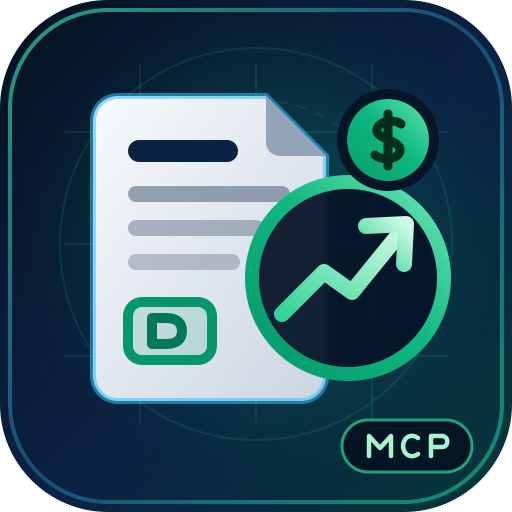
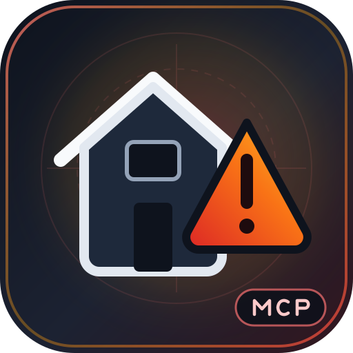

# Open Data B2B & Compliance MCP Servers + Apify Actors

Ten production-grade, **100% deterministic, zero-third-party-API-key** remote **Streamable HTTP Model Context Protocol (MCP)** servers and Apify Store Actors backed exclusively by official US/EU public-domain registries and RFC network protocols.

> [!IMPORTANT]
> **Early-Adopter Launch Pricing (`$0.50–$1.00 / 1,000 records`) — Limited Launch Window:**
> All 10 MCP servers & Apify Actors are currently live at **early-adopter launch rates (`$0.50–$1.00` per 1,000 records)** so early adopters can integrate and benchmark at near-compute cost. Once initial launch benchmarks are met, pricing will step up to our permanent **standard rates (`$1.50–$2.50` per 1,000 records)** — which still remain **75%–95% cheaper** than comparable Apify Store scrapers (`$10–$80/1k`).

## Why These MCP Servers?

- **Zero External API Keys or Proxies Required:** Every endpoint queries authoritative government APIs (SEC EDGAR, GLEIF LEI, USASpending, Grants.gov, CMS NPPES, US EPA ECHO, ClinicalTrials.gov, Europe PMC, USITC HTS, EC VIES, EU TED, Municipal Socrata portals) or native RFC protocols (DNS, TLS SNI, IANA RDAP, RIPEstat BGP).
- **Native Streamable HTTP MCP + REST Batch API:** Connect AI agents directly over `/mcp` (Apify Standby Mode) OR trigger batch JSON/CSV/Parquet runs via Apify REST API v2.
- **Pay-Per-Event Metering:** Only pay for normalized, deduplicated records returned.

---

## Live Remote MCP Servers & Apify Store Catalog

| Icon | MCP Server & Apify Store | Standby MCP Endpoint (`Streamable HTTP`) | Official Data Sources | Launch Price *(Upcoming Standard)* |
| :--- | :--- | :--- | :--- | :--- |
|  | **[SEC Form D Startup Funding](./servers/sec-form-d-funding-leads/README.md)**<br/><sub>[Apify Store](https://apify.com/desastreger/sec-form-d-funding-leads)</sub> | `https://desastreger--sec-form-d-funding-leads.apify.actor/mcp` | SEC EDGAR Form D XML, SEC Submissions API, USASpending.gov | **$1.00 / 1k** *(reg. $2.50 / 1k)* |
|  | **[US KYB Compliance Dossier](./servers/us-kyb-compliance-dossier/README.md)**<br/><sub>[Apify Store](https://apify.com/desastreger/us-kyb-compliance-dossier)</sub> | `https://desastreger--us-kyb-compliance-dossier.apify.actor/mcp` | GLEIF LEI, SEC EDGAR, FDA openFDA, CFPB, USASpending.gov | **$1.00 / 1k** *(reg. $2.50 / 1k)* |
|  | **[Federal GovCon Recompete Radar](./servers/federal-govcon-recompete-radar/README.md)**<br/><sub>[Apify Store](https://apify.com/desastreger/federal-govcon-recompete-radar)</sub> | `https://desastreger--federal-govcon-recompete-radar.apify.actor/mcp` | USASpending.gov, Grants.gov | **$0.80 / 1k** *(reg. $2.00 / 1k)* |
|  | **[US Metro Building & Trade Permits](./servers/us-metro-building-trade-permits/README.md)**<br/><sub>[Apify Store](https://apify.com/desastreger/us-metro-building-trade-permits)</sub> | `https://desastreger--us-metro-building-trade-permits.apify.actor/mcp` | LA, Chicago, Austin, SF & Seattle Socrata Open Data APIs | **$0.50 / 1k** *(reg. $1.50 / 1k)* |
|  | **[Cross-Border Tariff & EU Trade](./servers/cross-border-tariff-eu-trade-mcp/README.md)**<br/><sub>[Apify Store](https://apify.com/desastreger/cross-border-tariff-eu-trade-mcp)</sub> | `https://desastreger--cross-border-tariff-eu-trade-mcp.apify.actor/mcp` | USITC HTS API, European Commission VIES, EU TED API v3 | **$0.80 / 1k** *(reg. $2.00 / 1k)* |
|  | **[US Healthcare Practice Owners](./servers/us-healthcare-practice-owners/README.md)**<br/><sub>[Apify Store](https://apify.com/desastreger/us-healthcare-practice-owners)</sub> | `https://desastreger--us-healthcare-practice-owners.apify.actor/mcp` | CMS NPPES NPI Registry API v2.1 | **$0.50 / 1k** *(reg. $1.50 / 1k)* |
|  | **[B2B Domain & Mail Security Audit](./servers/b2b-domain-mail-security-posture/README.md)**<br/><sub>[Apify Store](https://apify.com/desastreger/b2b-domain-mail-security-posture)</sub> | `https://desastreger--b2b-domain-mail-security-posture.apify.actor/mcp` | Native RFC DNS (MX/SPF/DMARC/NS), TLS SNI, IANA RDAP, RIPEstat BGP | **$0.50 / 1k** *(reg. $1.50 / 1k)* |
|  | **[US Municipal Code Violations](./servers/us-municipal-code-violation-distressed-leads/README.md)**<br/><sub>[Apify Store](https://apify.com/desastreger/us-municipal-code-violation-distressed-leads)</sub> | `https://desastreger--us-municipal-code-violation-distressed-leads.apify.actor/mcp` | Austin, SF, Seattle, Buffalo, Montgomery MD & Cincinnati Socrata APIs | **$0.80 / 1k** *(reg. $2.00 / 1k)* |
|  | **[EPA ECHO Industrial Compliance](./servers/epa-echo-industrial-facility-compliance/README.md)**<br/><sub>[Apify Store](https://apify.com/desastreger/epa-echo-industrial-facility-compliance)</sub> | `https://desastreger--epa-echo-industrial-facility-compliance.apify.actor/mcp` | US EPA ECHO REST APIs (Clean Water NPDES, Clean Air, RCRA) | **$0.50 / 1k** *(reg. $1.50 / 1k)* |
|  | **[Clinical Trials & PubMed KOL Finder](./servers/openalex-pubmed-expert-finder-mcp/README.md)**<br/><sub>[Apify Store](https://apify.com/desastreger/openalex-pubmed-expert-finder-mcp)</sub> | `https://desastreger--openalex-pubmed-expert-finder-mcp.apify.actor/mcp` | NIH ClinicalTrials.gov REST API v2, EMBL-EBI Europe PMC / PubMed | **$0.50 / 1k** *(reg. $1.50 / 1k)* |

See [`server.json`](./server.json) for the machine-readable MCP Registry catalog manifest and [`mcp_config.example.json`](./mcp_config.example.json) for all 10 endpoints in one file.

---

## IDE & AI Client Setup (`mcp_config.json`)

Replace `<YOUR_APIFY_TOKEN>` with your personal [Apify API token](https://console.apify.com/settings/integrations) and pick the servers you want (example below connects **SEC Form D**, **US KYB**, and **Domain Security**):

### Claude Desktop / Cursor / Windsurf / Google Antigravity

- **Claude Desktop:** `~/Library/Application Support/Claude/claude_desktop_config.json` (macOS) or `%APPDATA%\Claude\claude_desktop_config.json` (Windows)
- **Cursor:** `~/.cursor/mcp.json` (global) or `.cursor/mcp.json` (workspace)
- **Windsurf:** `~/.codeium/windsurf/mcp_config.json`
- **Google Antigravity:** `~/.gemini/antigravity/mcp_config.json`

```json
{
  "mcpServers": {
    "sec-form-d-funding-leads": {
      "url": "https://desastreger--sec-form-d-funding-leads.apify.actor/mcp",
      "headers": {
        "Authorization": "Bearer <YOUR_APIFY_TOKEN>"
      }
    },
    "us-kyb-compliance-dossier": {
      "url": "https://desastreger--us-kyb-compliance-dossier.apify.actor/mcp",
      "headers": {
        "Authorization": "Bearer <YOUR_APIFY_TOKEN>"
      }
    },
    "b2b-domain-mail-security-posture": {
      "url": "https://desastreger--b2b-domain-mail-security-posture.apify.actor/mcp",
      "headers": {
        "Authorization": "Bearer <YOUR_APIFY_TOKEN>"
      }
    }
  }
}
```

### VS Code Copilot (`.vscode/mcp.json`)

```json
{
  "servers": {
    "sec-form-d-funding-leads": {
      "type": "http",
      "url": "https://desastreger--sec-form-d-funding-leads.apify.actor/mcp",
      "headers": {
        "Authorization": "Bearer <YOUR_APIFY_TOKEN>"
      }
    },
    "epa-echo-industrial-facility-compliance": {
      "type": "http",
      "url": "https://desastreger--epa-echo-industrial-facility-compliance.apify.actor/mcp",
      "headers": {
        "Authorization": "Bearer <YOUR_APIFY_TOKEN>"
      }
    }
  }
}
```

---

## API Quickstarts (cURL, JavaScript, Python)

### 1. cURL (Direct MCP JSON-RPC `tools/call`)

```bash
curl -sS -X POST "https://desastreger--sec-form-d-funding-leads.apify.actor/mcp" \
  -H "Authorization: Bearer <YOUR_APIFY_TOKEN>" \
  -H "Content-Type: application/json" \
  -H "Accept: application/json, text/event-stream" \
  -d '{
    "jsonrpc": "2.0",
    "id": 1,
    "method": "tools/call",
    "params": {
      "name": "search_startup_funding_leads",
      "arguments": {
        "daysBack": 7,
        "maxResults": 3,
        "operatingCompaniesOnly": true
      }
    }
  }'
```

### 2. JavaScript / Node.js (`apify-client`)

```js
import { ApifyClient } from 'apify-client';

const client = new ApifyClient({ token: process.env.APIFY_TOKEN });

const run = await client.actor('desastreger/us-kyb-compliance-dossier').call({
  companies: ['Pfizer', 'Medtronic'],
  includeGleifLei: true,
  includeSecFilings: true,
  includeFdaEnforcement: true,
});

const { items } = await client.dataset(run.defaultDatasetId).listItems();
console.log(items);
```

### 3. Python (`apify-client`)

```python
import os
from apify_client import ApifyClient

client = ApifyClient(os.environ["APIFY_TOKEN"])

run = client.actor("desastreger/us-metro-building-trade-permits").call(
    run_input={
        "metros": ["chicago", "austin"],
        "tradeFilter": "solar",
        "maxResults": 10,
    }
)

items = client.dataset(run["defaultDatasetId"]).list_items().items
print(items)
```

---

## License

MIT — see [`LICENSE`](./LICENSE).
