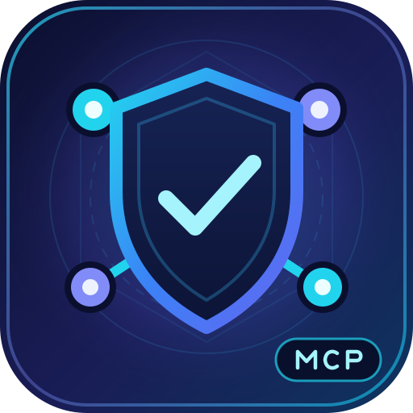
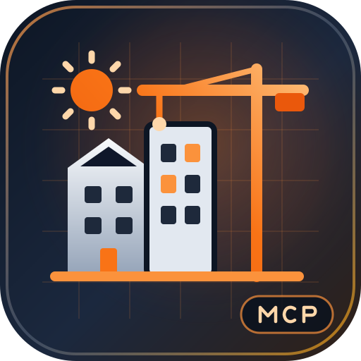
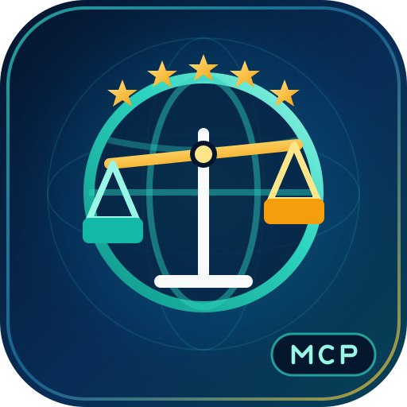
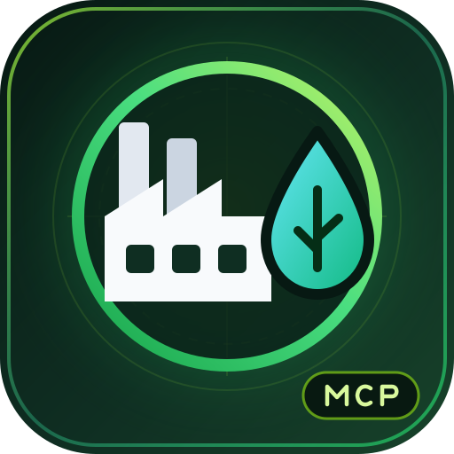
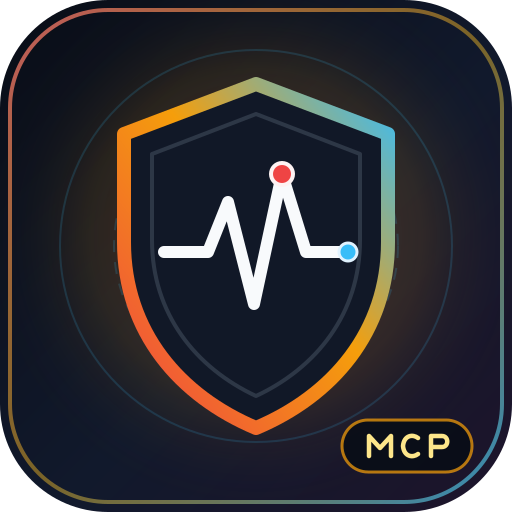
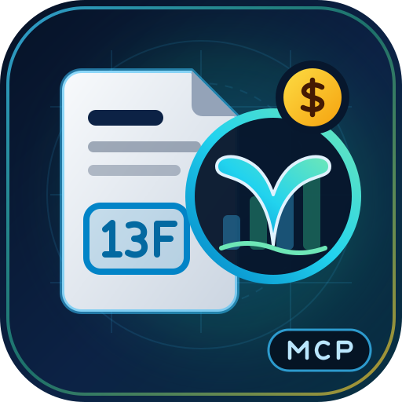
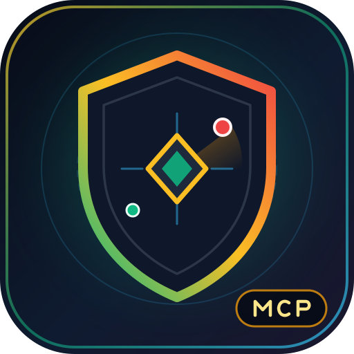
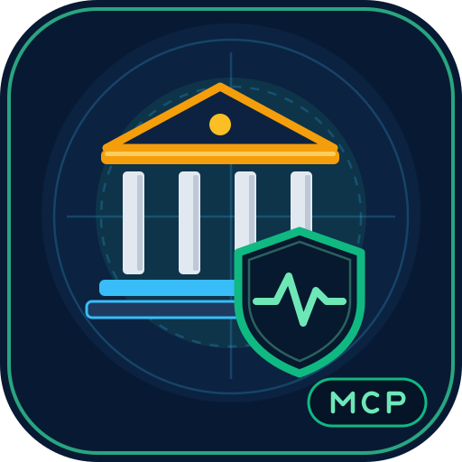
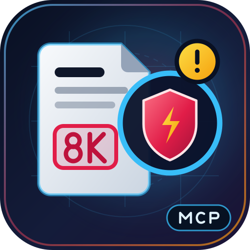

# Open Data B2B & Compliance MCP Servers + Apify Actors

[](https://m8ven.ai/mcp/desastreger-open-data-mcp-servers-fy4dv2?s=readme)
[](https://desastreger.github.io/open-data-mcp-servers/)
[](https://registry.modelcontextprotocol.io/)

Twenty production-grade, **100% deterministic, zero-third-party-API-key** remote **Streamable HTTP Model Context Protocol (MCP)** servers (plus a zero-dependency **52-tool local STDIO MCP router** in [`src/index.mjs`](./src/index.mjs)) and Apify Store Actors backed exclusively by official US/EU public-domain registries and RFC network protocols.

- **Interactive Showcase & Daily Live Data:** [https://desastreger.github.io/open-data-mcp-servers/](https://desastreger.github.io/open-data-mcp-servers/)
- **Daily Live Registry Snapshot:** [`samples/LATEST_SNAPSHOT.md`](./samples/LATEST_SNAPSHOT.md) *(refreshed daily at `07:15 UTC` via GitHub Actions)*
- **1-Click All-in-One OAuth MCP URL (Zero API Key Needed):** `https://mcp.apify.com/?tools=desastreger/sec-form-d-funding-leads,desastreger/us-kyb-compliance-dossier,desastreger/federal-govcon-recompete-radar,desastreger/us-metro-building-trade-permits,desastreger/cross-border-tariff-eu-trade-mcp,desastreger/us-healthcare-practice-owners,desastreger/b2b-domain-mail-security-posture,desastreger/us-municipal-code-violation-distressed-leads,desastreger/epa-echo-industrial-facility-compliance,desastreger/openalex-pubmed-expert-finder-mcp,desastreger/sec-form4-insider-cluster-signals,desastreger/fda-medtech-510k-approval-tracker,desastreger/irs-990-nonprofit-grantmaker-leads,desastreger/cisa-kev-nvd-exploit-prioritizer-mcp,desastreger/sec-13f-institutional-whale-holdings,desastreger/ofac-sanctions-aml-pep-screener-mcp,desastreger/federal-register-regulatory-rule-radar,desastreger/fdic-bank-financial-health-screener,desastreger/cpsc-consumer-product-recall-monitor,desastreger/sec-8k-material-events-cyber-ma-radar`

> [!IMPORTANT]
> **Early-Adopter Launch Pricing (`$0.50–$1.00 / 1,000 records`) — Limited Launch Window:**
> All 20 MCP servers & Apify Actors are currently live at **early-adopter launch rates (`$0.50–$1.00` per 1,000 records)** so early adopters can integrate and benchmark at near-compute cost. Once initial launch benchmarks are met, pricing will step up to our permanent **standard rates (`$1.50–$2.50` per 1,000 records)** — which still remain **75%–95% cheaper** than comparable Apify Store scrapers (`$10–$80/1k`).

## Why These MCP Servers?

- **1-Click Browser OAuth (Zero Manual Tokens):** Connect any single server or all 20 servers at once via `https://mcp.apify.com/?tools=desastreger/<slug>` — Claude Desktop, Claude Code, Cursor, Windsurf, VS Code, and Google Antigravity sign in seamlessly through browser OAuth.
- **Zero External API Keys or Proxies Required:** Every endpoint queries authoritative government APIs (FDIC BankFind Call Reports & Failures, CPSC SaferProducts, NHTSA Recalls, US Federal Register API v1, SEC EDGAR Form D, Form 4, Form 8-K & Form 13F-HR, US Treasury OFAC SDN/Consolidated SLS, IRS Form 990 via ProPublica, CISA KEV + FIRST.org EPSS + NIST NVD v2, FDA openFDA 510(k)/PMA/Recalls, GLEIF LEI, USASpending, Grants.gov, CMS NPPES, US EPA ECHO, ClinicalTrials.gov, Europe PMC, USITC HTS, EC VIES, EU TED, Municipal Socrata portals) or native RFC protocols (DNS, TLS SNI, IANA RDAP, RIPEstat BGP).
- **Native Streamable HTTP MCP + REST Batch API:** Connect AI agents directly over MCP OR trigger batch JSON/CSV/Parquet runs via Apify REST API v2, **n8n**, or **Clay**.
- **Pay-Per-Event Metering:** Only pay for normalized, deduplicated records returned.

---

## Live Remote MCP Servers & Apify Store Catalog

| Icon | MCP Server & Apify Store | 1-Click OAuth MCP (`Zero API Key`) & Standby Endpoint | Official Data Sources | Launch Price *(Upcoming Standard)* |
| :--- | :--- | :--- | :--- | :--- |
|  | **[SEC Form D Startup Funding](./servers/sec-form-d-funding-leads/README.md)**<br/><sub>[Apify Store](https://apify.com/desastreger/sec-form-d-funding-leads) · [SKILL.md](./skills/sec-form-d-funding-leads/SKILL.md)</sub> | **OAuth:** `https://mcp.apify.com/?tools=desastreger/sec-form-d-funding-leads`<br/>**Standby:** `https://desastreger--sec-form-d-funding-leads.apify.actor/mcp` | SEC EDGAR Form D XML, SEC Submissions API, USASpending.gov | **$1.00 / 1k** *(reg. $2.50 / 1k)* |
|  | **[US KYB Compliance Dossier](./servers/us-kyb-compliance-dossier/README.md)**<br/><sub>[Apify Store](https://apify.com/desastreger/us-kyb-compliance-dossier) · [SKILL.md](./skills/us-kyb-compliance-dossier/SKILL.md)</sub> | **OAuth:** `https://mcp.apify.com/?tools=desastreger/us-kyb-compliance-dossier`<br/>**Standby:** `https://desastreger--us-kyb-compliance-dossier.apify.actor/mcp` | GLEIF LEI, SEC EDGAR, FDA openFDA, CFPB, USASpending.gov | **$1.00 / 1k** *(reg. $2.50 / 1k)* |
|  | **[Federal GovCon Recompete Radar](./servers/federal-govcon-recompete-radar/README.md)**<br/><sub>[Apify Store](https://apify.com/desastreger/federal-govcon-recompete-radar) · [SKILL.md](./skills/federal-govcon-recompete-radar/SKILL.md)</sub> | **OAuth:** `https://mcp.apify.com/?tools=desastreger/federal-govcon-recompete-radar`<br/>**Standby:** `https://desastreger--federal-govcon-recompete-radar.apify.actor/mcp` | USASpending.gov, Grants.gov | **$0.80 / 1k** *(reg. $2.00 / 1k)* |
|  | **[US Metro Building & Trade Permits](./servers/us-metro-building-trade-permits/README.md)**<br/><sub>[Apify Store](https://apify.com/desastreger/us-metro-building-trade-permits) · [SKILL.md](./skills/us-metro-building-trade-permits/SKILL.md)</sub> | **OAuth:** `https://mcp.apify.com/?tools=desastreger/us-metro-building-trade-permits`<br/>**Standby:** `https://desastreger--us-metro-building-trade-permits.apify.actor/mcp` | LA, Chicago, Austin, SF & Seattle Socrata Open Data APIs | **$0.50 / 1k** *(reg. $1.50 / 1k)* |
|  | **[Cross-Border Tariff & EU Trade](./servers/cross-border-tariff-eu-trade-mcp/README.md)**<br/><sub>[Apify Store](https://apify.com/desastreger/cross-border-tariff-eu-trade-mcp) · [SKILL.md](./skills/cross-border-tariff-eu-trade-mcp/SKILL.md)</sub> | **OAuth:** `https://mcp.apify.com/?tools=desastreger/cross-border-tariff-eu-trade-mcp`<br/>**Standby:** `https://desastreger--cross-border-tariff-eu-trade-mcp.apify.actor/mcp` | USITC HTS API, European Commission VIES, EU TED API v3 | **$0.80 / 1k** *(reg. $2.00 / 1k)* |
|  | **[US Healthcare Practice Owners](./servers/us-healthcare-practice-owners/README.md)**<br/><sub>[Apify Store](https://apify.com/desastreger/us-healthcare-practice-owners) · [SKILL.md](./skills/us-healthcare-practice-owners/SKILL.md)</sub> | **OAuth:** `https://mcp.apify.com/?tools=desastreger/us-healthcare-practice-owners`<br/>**Standby:** `https://desastreger--us-healthcare-practice-owners.apify.actor/mcp` | CMS NPPES NPI Registry API v2.1 | **$0.50 / 1k** *(reg. $1.50 / 1k)* |
|  | **[B2B Domain & Mail Security Audit](./servers/b2b-domain-mail-security-posture/README.md)**<br/><sub>[Apify Store](https://apify.com/desastreger/b2b-domain-mail-security-posture) · [SKILL.md](./skills/b2b-domain-mail-security-posture/SKILL.md)</sub> | **OAuth:** `https://mcp.apify.com/?tools=desastreger/b2b-domain-mail-security-posture`<br/>**Standby:** `https://desastreger--b2b-domain-mail-security-posture.apify.actor/mcp` | Native RFC DNS (MX/SPF/DMARC/NS), TLS SNI, IANA RDAP, RIPEstat BGP | **$0.50 / 1k** *(reg. $1.50 / 1k)* |
|  | **[US Municipal Code Violations](./servers/us-municipal-code-violation-distressed-leads/README.md)**<br/><sub>[Apify Store](https://apify.com/desastreger/us-municipal-code-violation-distressed-leads) · [SKILL.md](./skills/us-municipal-code-violation-distressed-leads/SKILL.md)</sub> | **OAuth:** `https://mcp.apify.com/?tools=desastreger/us-municipal-code-violation-distressed-leads`<br/>**Standby:** `https://desastreger--us-municipal-code-violation-distressed-leads.apify.actor/mcp` | Austin, SF, Seattle, Buffalo, Montgomery MD & Cincinnati Socrata APIs | **$0.80 / 1k** *(reg. $2.00 / 1k)* |
|  | **[EPA ECHO Industrial Compliance](./servers/epa-echo-industrial-facility-compliance/README.md)**<br/><sub>[Apify Store](https://apify.com/desastreger/epa-echo-industrial-facility-compliance) · [SKILL.md](./skills/epa-echo-industrial-facility-compliance/SKILL.md)</sub> | **OAuth:** `https://mcp.apify.com/?tools=desastreger/epa-echo-industrial-facility-compliance`<br/>**Standby:** `https://desastreger--epa-echo-industrial-facility-compliance.apify.actor/mcp` | US EPA ECHO REST APIs (Clean Water NPDES, Clean Air, RCRA) | **$0.50 / 1k** *(reg. $1.50 / 1k)* |
|  | **[Clinical Trials & PubMed KOL Finder](./servers/openalex-pubmed-expert-finder-mcp/README.md)**<br/><sub>[Apify Store](https://apify.com/desastreger/openalex-pubmed-expert-finder-mcp) · [SKILL.md](./skills/openalex-pubmed-expert-finder-mcp/SKILL.md)</sub> | **OAuth:** `https://mcp.apify.com/?tools=desastreger/openalex-pubmed-expert-finder-mcp`<br/>**Standby:** `https://desastreger--openalex-pubmed-expert-finder-mcp.apify.actor/mcp` | NIH ClinicalTrials.gov REST API v2, EMBL-EBI Europe PMC / PubMed | **$0.50 / 1k** *(reg. $1.50 / 1k)* |
|  | **[SEC Form 4 Insider & Cluster Buys](./servers/sec-form4-insider-cluster-signals/README.md)**<br/><sub>[Apify Store](https://apify.com/desastreger/sec-form4-insider-cluster-signals) · [SKILL.md](./skills/sec-form4-insider-cluster-signals/SKILL.md)</sub> | **OAuth:** `https://mcp.apify.com/?tools=desastreger/sec-form4-insider-cluster-signals`<br/>**Standby:** `https://desastreger--sec-form4-insider-cluster-signals.apify.actor/mcp` | SEC EDGAR Form 4 XML, SEC Submissions API, SEC EFTS API | **$0.80 / 1k** *(reg. $2.00 / 1k)* |
|  | **[FDA 510(k) & PMA MedTech Clearances](./servers/fda-medtech-510k-approval-tracker/README.md)**<br/><sub>[Apify Store](https://apify.com/desastreger/fda-medtech-510k-approval-tracker) · [SKILL.md](./skills/fda-medtech-510k-approval-tracker/SKILL.md)</sub> | **OAuth:** `https://mcp.apify.com/?tools=desastreger/fda-medtech-510k-approval-tracker`<br/>**Standby:** `https://desastreger--fda-medtech-510k-approval-tracker.apify.actor/mcp` | US FDA openFDA Device APIs (510(k), PMA, Enforcement Recalls) | **$0.80 / 1k** *(reg. $2.00 / 1k)* |
|  | **[IRS Form 990 Nonprofit & Foundation Grantmakers](./servers/irs-990-nonprofit-grantmaker-leads/README.md)**<br/><sub>[Apify Store](https://apify.com/desastreger/irs-990-nonprofit-grantmaker-leads) · [SKILL.md](./skills/irs-990-nonprofit-grantmaker-leads/SKILL.md)</sub> | **OAuth:** `https://mcp.apify.com/?tools=desastreger/irs-990-nonprofit-grantmaker-leads`<br/>**Standby:** `https://desastreger--irs-990-nonprofit-grantmaker-leads.apify.actor/mcp` | ProPublica Nonprofit Explorer API v2, IRS EO BMF, Form 990/990-PF/990-EZ | **$0.50 / 1k** *(reg. $1.50 / 1k)* |
|  | **[CISA KEV, EPSS & NVD Exploit Prioritizer](./servers/cisa-kev-nvd-exploit-prioritizer-mcp/README.md)**<br/><sub>[Apify Store](https://apify.com/desastreger/cisa-kev-nvd-exploit-prioritizer-mcp) · [SKILL.md](./skills/cisa-kev-nvd-exploit-prioritizer-mcp/SKILL.md)</sub> | **OAuth:** `https://mcp.apify.com/?tools=desastreger/cisa-kev-nvd-exploit-prioritizer-mcp`<br/>**Standby:** `https://desastreger--cisa-kev-nvd-exploit-prioritizer-mcp.apify.actor/mcp` | CISA KEV Catalog, FIRST.org EPSS v1, NIST NVD CVE API v2 | **$0.50 / 1k** *(reg. $1.50 / 1k)* |
|  | **[SEC Form 13F Hedge Fund & Whale Holdings](./servers/sec-13f-institutional-whale-holdings/README.md)**<br/><sub>[Apify Store](https://apify.com/desastreger/sec-13f-institutional-whale-holdings) · [SKILL.md](./skills/sec-13f-institutional-whale-holdings/SKILL.md)</sub> | **OAuth:** `https://mcp.apify.com/?tools=desastreger/sec-13f-institutional-whale-holdings`<br/>**Standby:** `https://desastreger--sec-13f-institutional-whale-holdings.apify.actor/mcp` | SEC EDGAR Form 13F-HR XML, SEC Submissions & EFTS APIs | **$0.80 / 1k** *(reg. $2.00 / 1k)* |
|  | **[OFAC Sanctions, AML & Crypto Wallet Screener](./servers/ofac-sanctions-aml-pep-screener-mcp/README.md)**<br/><sub>[Apify Store](https://apify.com/desastreger/ofac-sanctions-aml-pep-screener-mcp) · [SKILL.md](./skills/ofac-sanctions-aml-pep-screener-mcp/SKILL.md)</sub> | **OAuth:** `https://mcp.apify.com/?tools=desastreger/ofac-sanctions-aml-pep-screener-mcp`<br/>**Standby:** `https://desastreger--ofac-sanctions-aml-pep-screener-mcp.apify.actor/mcp` | US Treasury OFAC SLS (`SDN.CSV`, `ALT.CSV`, `ADD.CSV`, `CONS_PRIM.CSV`) | **$0.80 / 1k** *(reg. $2.00 / 1k)* |
|  | **[US Federal Register Rules, Notices & Executive Orders](./servers/federal-register-regulatory-rule-radar/README.md)**<br/><sub>[Apify Store](https://apify.com/desastreger/federal-register-regulatory-rule-radar) · [SKILL.md](./skills/federal-register-regulatory-rule-radar/SKILL.md)</sub> | **OAuth:** `https://mcp.apify.com/?tools=desastreger/federal-register-regulatory-rule-radar`<br/>**Standby:** `https://desastreger--federal-register-regulatory-rule-radar.apify.actor/mcp` | US Federal Register REST API v1 (`federalregister.gov/api/v1`) | **$0.50 / 1k** *(reg. $1.50 / 1k)* |
|  | **[FDIC Bank Financial Health & Call Reports](./servers/fdic-bank-financial-health-screener/README.md)**<br/><sub>[Apify Store](https://apify.com/desastreger/fdic-bank-financial-health-screener) · [SKILL.md](./skills/fdic-bank-financial-health-screener/SKILL.md)</sub> | **OAuth:** `https://mcp.apify.com/?tools=desastreger/fdic-bank-financial-health-screener`<br/>**Standby:** `https://desastreger--fdic-bank-financial-health-screener.apify.actor/mcp` | FDIC BankFind Suite API (Institutions, Call Reports, Failures), CFPB Complaints | **$0.80 / 1k** *(reg. $2.00 / 1k)* |
|  | **[US Product, Vehicle, Food & Drug Recalls (CPSC, NHTSA, FDA)](./servers/cpsc-consumer-product-recall-monitor/README.md)**<br/><sub>[Apify Store](https://apify.com/desastreger/cpsc-consumer-product-recall-monitor) · [SKILL.md](./skills/cpsc-consumer-product-recall-monitor/SKILL.md)</sub> | **OAuth:** `https://mcp.apify.com/?tools=desastreger/cpsc-consumer-product-recall-monitor`<br/>**Standby:** `https://desastreger--cpsc-consumer-product-recall-monitor.apify.actor/mcp` | US CPSC SaferProducts, US NHTSA Recalls API, US openFDA Food & Drug Enforcements | **$0.50 / 1k** *(reg. $1.50 / 1k)* |
|  | **[SEC Form 8-K Material Events, M&A, Cyber & CEO](./servers/sec-8k-material-events-cyber-ma-radar/README.md)**<br/><sub>[Apify Store](https://apify.com/desastreger/sec-8k-material-events-cyber-ma-radar) · [SKILL.md](./skills/sec-8k-material-events-cyber-ma-radar/SKILL.md)</sub> | **OAuth:** `https://mcp.apify.com/?tools=desastreger/sec-8k-material-events-cyber-ma-radar`<br/>**Standby:** `https://desastreger--sec-8k-material-events-cyber-ma-radar.apify.actor/mcp` | SEC EDGAR EFTS (`efts.sec.gov`) & Submissions API (`data.sec.gov`) | **$0.80 / 1k** *(reg. $2.00 / 1k)* |

See [`server.json`](./server.json) for the Official MCP Registry manifest, [`catalog.json`](./catalog.json) for the full 20-server metadata catalog, and [`mcp_config.example.json`](./mcp_config.example.json) for ready-to-paste client configs.

---

## Install Ready-to-Use Agent Skills (`SKILL.md`)

Every server in this repository ships an open-standard [`skills/<slug>/SKILL.md`](./skills) playbook (including parameter schemas, query recipes, and executive report templates) indexed on [`skills.sh`](https://skills.sh) and compatible with **Claude Code**, **Cursor**, **Codex CLI**, **Gemini CLI**, **GitHub Copilot**, **OpenClaw**, and **Google Antigravity**:

```bash
# Install all 20 open-data skills via the open skills CLI (Claude Code / Cursor / Codex / Antigravity)
npx skills add desastreger/open-data-mcp-servers --all

# Or copy a single skill directly into Claude Code / Antigravity:
git clone https://github.com/desastreger/open-data-mcp-servers.git
cp -r open-data-mcp-servers/skills/sec-form-d-funding-leads ~/.claude/skills/
```

---

## IDE & AI Client Setup (`mcp_config.json`)

### Option 1: 1-Click Browser OAuth (Zero Manual API Key — Recommended)

Use Apify's managed OAuth MCP gateway (`https://mcp.apify.com/?tools=desastreger/<slug>`). Your MCP client automatically opens a browser login once — **no `APIFY_TOKEN` header required**.

#### Claude Code CLI (All 20 Servers in One Command)

```bash
claude mcp add --transport http open-data-mcp-suite \
  "https://mcp.apify.com/?tools=desastreger/sec-form-d-funding-leads,desastreger/us-kyb-compliance-dossier,desastreger/federal-govcon-recompete-radar,desastreger/us-metro-building-trade-permits,desastreger/cross-border-tariff-eu-trade-mcp,desastreger/us-healthcare-practice-owners,desastreger/b2b-domain-mail-security-posture,desastreger/us-municipal-code-violation-distressed-leads,desastreger/epa-echo-industrial-facility-compliance,desastreger/openalex-pubmed-expert-finder-mcp,desastreger/sec-form4-insider-cluster-signals,desastreger/fda-medtech-510k-approval-tracker,desastreger/irs-990-nonprofit-grantmaker-leads,desastreger/cisa-kev-nvd-exploit-prioritizer-mcp,desastreger/sec-13f-institutional-whale-holdings,desastreger/ofac-sanctions-aml-pep-screener-mcp,desastreger/federal-register-regulatory-rule-radar,desastreger/fdic-bank-financial-health-screener,desastreger/cpsc-consumer-product-recall-monitor,desastreger/sec-8k-material-events-cyber-ma-radar"
```

#### Claude Desktop / Cursor / Windsurf / Google Antigravity

- **Claude Desktop:** `~/Library/Application Support/Claude/claude_desktop_config.json` (macOS) or `%APPDATA%\Claude\claude_desktop_config.json` (Windows)
- **Cursor:** `~/.cursor/mcp.json` (global) or `.cursor/mcp.json` (workspace)
- **Windsurf:** `~/.codeium/windsurf/mcp_config.json`
- **Google Antigravity:** `~/.gemini/antigravity/mcp_config.json`

```json
{
  "mcpServers": {
    "open-data-mcp-suite": {
      "url": "https://mcp.apify.com/?tools=desastreger/sec-form-d-funding-leads,desastreger/us-kyb-compliance-dossier,desastreger/federal-govcon-recompete-radar,desastreger/us-metro-building-trade-permits,desastreger/cross-border-tariff-eu-trade-mcp,desastreger/us-healthcare-practice-owners,desastreger/b2b-domain-mail-security-posture,desastreger/us-municipal-code-violation-distressed-leads,desastreger/epa-echo-industrial-facility-compliance,desastreger/openalex-pubmed-expert-finder-mcp,desastreger/sec-form4-insider-cluster-signals,desastreger/fda-medtech-510k-approval-tracker,desastreger/irs-990-nonprofit-grantmaker-leads,desastreger/cisa-kev-nvd-exploit-prioritizer-mcp,desastreger/sec-13f-institutional-whale-holdings,desastreger/ofac-sanctions-aml-pep-screener-mcp,desastreger/federal-register-regulatory-rule-radar,desastreger/fdic-bank-financial-health-screener,desastreger/cpsc-consumer-product-recall-monitor,desastreger/sec-8k-material-events-cyber-ma-radar"
    }
  }
}
```

#### VS Code Copilot (`.vscode/mcp.json`)

```json
{
  "servers": {
    "open-data-mcp-suite": {
      "type": "http",
      "url": "https://mcp.apify.com/?tools=desastreger/sec-form-d-funding-leads,desastreger/us-kyb-compliance-dossier,desastreger/federal-govcon-recompete-radar,desastreger/us-metro-building-trade-permits,desastreger/cross-border-tariff-eu-trade-mcp,desastreger/us-healthcare-practice-owners,desastreger/b2b-domain-mail-security-posture,desastreger/us-municipal-code-violation-distressed-leads,desastreger/epa-echo-industrial-facility-compliance,desastreger/openalex-pubmed-expert-finder-mcp,desastreger/sec-form4-insider-cluster-signals,desastreger/fda-medtech-510k-approval-tracker,desastreger/irs-990-nonprofit-grantmaker-leads,desastreger/cisa-kev-nvd-exploit-prioritizer-mcp,desastreger/sec-13f-institutional-whale-holdings,desastreger/ofac-sanctions-aml-pep-screener-mcp,desastreger/federal-register-regulatory-rule-radar,desastreger/fdic-bank-financial-health-screener,desastreger/cpsc-consumer-product-recall-monitor,desastreger/sec-8k-material-events-cyber-ma-radar"
    }
  }
}
```

### Option 2: Direct Standby Streamable HTTP (`Bearer $APIFY_TOKEN`)

For headless agents, CI pipelines, or direct token-authenticated requests, replace `<YOUR_APIFY_TOKEN>` with your [Apify API token](https://console.apify.com/settings/integrations):

```json
{
  "mcpServers": {
    "sec-form-d-funding-leads": {
      "url": "https://desastreger--sec-form-d-funding-leads.apify.actor/mcp",
      "headers": {
        "Authorization": "Bearer <YOUR_APIFY_TOKEN>"
      }
    },
    "us-kyb-compliance-dossier": {
      "url": "https://desastreger--us-kyb-compliance-dossier.apify.actor/mcp",
      "headers": {
        "Authorization": "Bearer <YOUR_APIFY_TOKEN>"
      }
    },
    "b2b-domain-mail-security-posture": {
      "url": "https://desastreger--b2b-domain-mail-security-posture.apify.actor/mcp",
      "headers": {
        "Authorization": "Bearer <YOUR_APIFY_TOKEN>"
      }
    }
  }
}
```

### Option 3: Unified Local STDIO Router (All 52 Read-Only Tools via One Entrypoint)

For MCP clients that prefer local `stdio` transport, run the zero-dependency router in [`src/index.mjs`](./src/index.mjs):

```json
{
  "mcpServers": {
    "open-data-mcp-router": {
      "command": "npx",
      "args": ["-y", "open-data-mcp-servers"],
      "env": {
        "APIFY_TOKEN": "<YOUR_APIFY_TOKEN>"
      }
    }
  }
}
```

---

## Ready-to-Import Automation Templates (`n8n` & `Clay`)

- **n8n Workflows (`templates/n8n/`):**
  - [`sec-form-d-daily-funded-startups-slack.json`](./templates/n8n/sec-form-d-daily-funded-startups-slack.json) — Daily SEC Form D `$250k+` operating startup funding alerts to Slack.
  - [`govcon-expiring-contracts-crm.json`](./templates/n8n/govcon-expiring-contracts-crm.json) — Weekly USASpending expiring federal contract recompete sync to CRM webhook.
  - [`kyb-compliance-vendor-webhook.json`](./templates/n8n/kyb-compliance-vendor-webhook.json) — Real-time vendor onboarding KYB webhook screening across GLEIF LEI, SEC, FDA, CFPB, and USASpending.
  - [`cisa-kev-critical-cve-slack.json`](./templates/n8n/cisa-kev-critical-cve-slack.json) — Daily CISA KEV newly added & ransomware-linked CVE alerts with EPSS & CVSS to Slack.
  - [`ofac-aml-counterparty-screening-webhook.json`](./templates/n8n/ofac-aml-counterparty-screening-webhook.json) — Real-time FinTech/KYB onboarding webhook screening counterparties & crypto wallets against US Treasury OFAC SDN & Consolidated lists.
  - [`federal-register-comment-deadline-slack.json`](./templates/n8n/federal-register-comment-deadline-slack.json) — Daily US Federal Register open public comment deadlines & OMB significant rule alerts to Slack.
  - [`fdic-bank-counterparty-risk-monitor.json`](./templates/n8n/fdic-bank-counterparty-risk-monitor.json) — Daily FDIC BankFind Call Report & failure screening alert for corporate treasury and sponsor-bank counterparties to Slack.
  - [`cpsc-fda-product-recall-slack-alert.json`](./templates/n8n/cpsc-fda-product-recall-slack-alert.json) — Daily US CPSC consumer product & openFDA food/drug high-severity recall compliance alerts to Slack.
  - [`sec-8k-cyber-breach-ma-webhook.json`](./templates/n8n/sec-8k-cyber-breach-ma-webhook.json) — Real-time webhook scanning SEC EDGAR Form 8-K filings for Item 1.05 cybersecurity breaches, M&A deals, and C-suite departures.
- **Clay HTTP API Enrichment (`templates/clay/README.md`):**
  - Copy-paste HTTP API column setups for Form D funding/EINs, KYB risk dossiers, DNS/DMARC mail stack audits, healthcare clinic owners, EPA compliance checks, FDIC bank health, CPSC/FDA recalls, and SEC Form 8-K triggers in [`templates/clay/README.md`](./templates/clay/README.md).

---

## API Quickstarts (cURL, JavaScript, Python)

### 1. cURL (Direct MCP JSON-RPC `tools/call`)

```bash
curl -sS -X POST "https://desastreger--sec-form-d-funding-leads.apify.actor/mcp" \
  -H "Authorization: Bearer <YOUR_APIFY_TOKEN>" \
  -H "Content-Type: application/json" \
  -H "Accept: application/json, text/event-stream" \
  -d '{
    "jsonrpc": "2.0",
    "id": 1,
    "method": "tools/call",
    "params": {
      "name": "search_startup_funding_leads",
      "arguments": {
        "daysBack": 7,
        "maxResults": 3,
        "operatingCompaniesOnly": true
      }
    }
  }'
```

### 2. JavaScript / Node.js (`apify-client`)

```js
import { ApifyClient } from 'apify-client';

const client = new ApifyClient({ token: process.env.APIFY_TOKEN });

const run = await client.actor('desastreger/us-kyb-compliance-dossier').call({
  companies: ['Pfizer', 'Medtronic'],
  includeGleifLei: true,
  includeSecFilings: true,
  includeFdaEnforcement: true,
});

const { items } = await client.dataset(run.defaultDatasetId).listItems();
console.log(items);
```

### 3. Python (`apify-client`)

```python
import os
from apify_client import ApifyClient

client = ApifyClient(os.environ["APIFY_TOKEN"])

run = client.actor("desastreger/us-metro-building-trade-permits").call(
    run_input={
        "metros": ["chicago", "austin"],
        "tradeFilter": "solar",
        "maxResults": 10,
    }
)

items = client.dataset(run["defaultDatasetId"]).list_items().items
print(items)
```

---

## License

MIT — see [`LICENSE`](./LICENSE).
