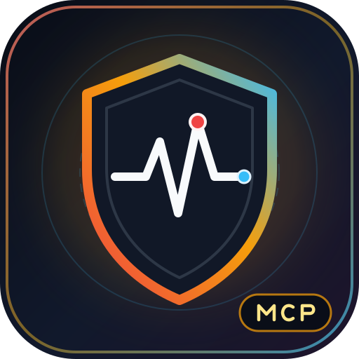

# CISA KEV, EPSS & NVD Exploited CVE Vulnerability Scanner

**Category:** Cybersecurity, SecOps & Vulnerability Triage  
**Apify Store:** [https://apify.com/desastreger/cisa-kev-nvd-exploit-prioritizer-mcp](https://apify.com/desastreger/cisa-kev-nvd-exploit-prioritizer-mcp)  
**1-Click OAuth MCP (Zero API Key):** `https://mcp.apify.com/?tools=desastreger/cisa-kev-nvd-exploit-prioritizer-mcp`  
**Direct Standby MCP (Bearer Token):** `https://desastreger--cisa-kev-nvd-exploit-prioritizer-mcp.apify.actor/mcp`  
**Official Data Sources:** CISA Known Exploited Vulnerabilities (KEV) Catalog, FIRST.org EPSS API v1, NIST NVD CVE API v2

> [!IMPORTANT]
> **Early-Adopter Launch Pricing:** **$0.50 / 1k advisories** (`$0.0005`/advisory) — promotional launch pricing for early Store adopters & MCP integrations. Zero external security API keys or proxies required.

## Overview

Fuse three authoritative, zero-key public cybersecurity intelligence feeds into one deterministic `0–100` `patchPriorityScore` ranking (`CRITICAL_RANSOMWARE`, `IMMEDIATE_KEV`, `HIGH_EPSS`, `STANDARD`):
1. **CISA Known Exploited Vulnerabilities (KEV) Catalog** — active exploitation status, `knownRansomwareCampaignUse`, `requiredAction`, CWEs, and federal BOD `dueDate` deadlines.
2. **FIRST.org EPSS v1 API** — live 30-day exploitation probability (`epssScore`) and percentile (`epssPercentile`).
3. **NIST NVD v2 CVE API** — optional CVSS v3.1 / v4.0 base score, severity, vector string, and analysis status with graceful `403`/`429` degradation.

- **Zero External API Keys:** Runs 100% deterministically against public-domain CISA, FIRST.org, and NIST NVD APIs.
- **Dual Mode:** Call live over MCP (`Streamable HTTP`) from Claude, Cursor, Windsurf, VS Code, or Google Antigravity, OR run batch jobs on [Apify Store](https://apify.com/desastreger/cisa-kev-nvd-exploit-prioritizer-mcp).

---

## MCP Tool Schemas

### `search_exploited_vulnerabilities`

Search and prioritize active CISA Known Exploited Vulnerabilities (KEV) filtered by vendor, product, keyword, ransomware linkage, KEV `dateAdded` window, or minimum FIRST.org EPSS probability.

| Parameter | Type | Description |
| :--- | :--- | :--- |
| `cveIds` | `array` | Optional specific CVE IDs to include and score (e.g., `["CVE-2024-3400"]`). |
| `vendorProject` | `string` | Optional vendor/project substring filter (e.g., `"Microsoft"`, `"Cisco"`, `"Fortinet"`). |
| `product` | `string` | Optional product substring filter (e.g., `"Windows"`, `"PAN-OS"`, `"IOS XE"`). |
| `keyword` | `string` | Optional keyword or CWE across CVE ID, vendor, product, title, and description. |
| `ransomwareOnly` | `boolean` | Filter to CVEs with `knownRansomwareCampaignUse = "Known"`. Default: false. |
| `daysBack` | `integer` | KEV `dateAdded` lookback window in days (1-3650). Falls back to most recent matches if 0 inside window when `vendorProject`/`cveIds` is set. Default: 90. |
| `minEpssScore` | `number` | Minimum FIRST.org EPSS 30d exploit probability (0.0 to 1.0). Default: 0. |
| `includeNvdCvss` | `boolean` | Optionally enrich top 3 matched CVEs with NIST NVD v2 CVSS severity/vector. Default: false. |
| `maxResults` | `integer` | Maximum prioritized advisories to return (1-50 in MCP mode). Default: 10. |

### `score_cve_exploit_risk`

Score 1 to 10 specific CVE identifiers by fusing CISA KEV active-exploitation status, FIRST.org EPSS probability/percentile, and NIST NVD v2 CVSS `baseScore` into a deterministic `0–100` patch priority dossier.

| Parameter | Type | Description |
| :--- | :--- | :--- |
| `cveId` | `string` | Single CVE ID to score (e.g., `"CVE-2024-3400"`). |
| `cveIds` | `array` | Optional array of up to 10 CVE IDs to score in one call. |
| `includeNvdCvss` | `boolean` | Fetch NIST NVD v2 CVSS `baseScore`, vector, and analysis status (capped at 3 CVEs unauthenticated). Default: true. |

### `summarize_vendor_kev_exposure`

Summarize a software or hardware vendor/project exposure across the live CISA KEV catalog, reporting total KEV entries, ransomware-linked count, overdue BOD directives, top affected products, top CWEs, and EPSS-ranked top vulnerabilities.

| Parameter | Type | Description |
| :--- | :--- | :--- |
| `vendorProject` | `string` **(required)** | Vendor or project name substring (e.g., `"Cisco"`, `"Microsoft"`, `"Ivanti"`, `"Fortinet"`). |
| `product` | `string` | Optional product substring filter within the vendor exposure summary. |
| `daysBack` | `integer` | Historical KEV lookback window in days (1-3650). Default: 3650 (full catalog). |
| `ransomwareOnly` | `boolean` | Restrict vendor summary to ransomware-linked KEV entries. Default: false. |
| `includeNvdCvss` | `boolean` | Optionally enrich top 3 vendor advisories with NIST NVD v2 CVSS. Default: false. |
| `maxResults` | `integer` | Maximum top-ranked vulnerabilities to include in the vendor summary (1-50). Default: 15. |

---

## Sample Output JSON

```json
{
  "cveId": "CVE-2026-132224",
  "inCisaKev": true,
  "vendorProject": "Optimizely",
  "product": "Web Experimentation",
  "vulnerabilityName": "Optimizely Web Experimentation External Control of Critical State Data Vulnerability",
  "dateAdded": "2026-11-24",
  "dueDate": "2026-11-27",
  "daysUntilDue": 2,
  "dueStatus": "DUE_SOON_7D",
  "knownRansomwareCampaignUse": "Unknown",
  "isRansomwareLinked": false,
  "forensicTriageRequired": true,
  "cwes": ["CWE-642"],
  "epssScore": 0.00411,
  "epssPercentile": 0.35845,
  "cvssVersion": "4.0",
  "cvssBaseScore": 7.1,
  "cvssSeverity": "HIGH",
  "patchPriorityScore": 53,
  "priorityTier": "IMMEDIATE_KEV",
  "kevCatalogVersion": "2026.11.24",
  "nvdUrl": "https://nvd.nist.gov/vuln/detail/CVE-2026-132224"
}
```

---

## Quickstart

### Option 1: 1-Click Browser OAuth (Zero API Key Setup)

Connect directly via Apify's managed OAuth MCP gateway — your AI client opens a browser login once and requires **no manual `APIFY_TOKEN`** in config files:

```bash
# Claude Code CLI (1-Click OAuth)
claude mcp add --transport http cisa-kev-nvd-exploit-prioritizer-mcp "https://mcp.apify.com/?tools=desastreger/cisa-kev-nvd-exploit-prioritizer-mcp"
```

**Claude Desktop / Cursor / Windsurf / Google Antigravity (`mcp_config.json`):**
```json
{
  "mcpServers": {
    "cisa-kev-nvd-exploit-prioritizer-mcp": {
      "url": "https://mcp.apify.com/?tools=desastreger/cisa-kev-nvd-exploit-prioritizer-mcp"
    }
  }
}
```

**VS Code Copilot (`.vscode/mcp.json`):**
```json
{
  "servers": {
    "cisa-kev-nvd-exploit-prioritizer-mcp": {
      "type": "http",
      "url": "https://mcp.apify.com/?tools=desastreger/cisa-kev-nvd-exploit-prioritizer-mcp"
    }
  }
}
```

### Option 2: Direct Standby Streamable HTTP (`Bearer $APIFY_TOKEN`)

For headless automation, CI/CD, or direct token-authenticated clients:

```json
{
  "mcpServers": {
    "cisa-kev-nvd-exploit-prioritizer-mcp": {
      "url": "https://desastreger--cisa-kev-nvd-exploit-prioritizer-mcp.apify.actor/mcp",
      "headers": {
        "Authorization": "Bearer <YOUR_APIFY_TOKEN>"
      }
    }
  }
}
```

### cURL (`tools/call`)

```bash
curl -sS -X POST "https://desastreger--cisa-kev-nvd-exploit-prioritizer-mcp.apify.actor/mcp" \
  -H "Authorization: Bearer <YOUR_APIFY_TOKEN>" \
  -H "Content-Type: application/json" \
  -H "Accept: application/json, text/event-stream" \
  -d '{"jsonrpc":"2.0","id":1,"method":"tools/call","params":{"name":"search_exploited_vulnerabilities","arguments":{"daysBack":90,"ransomwareOnly":true,"maxResults":5}}}'
```

### JavaScript (`apify-client`)

```js
import { ApifyClient } from 'apify-client';

const client = new ApifyClient({ token: process.env.APIFY_TOKEN });
const run = await client.actor('desastreger/cisa-kev-nvd-exploit-prioritizer-mcp').call({
  daysBack: 90,
  ransomwareOnly: true,
  includeNvdCvss: false,
  maxResults: 25,
});
const { items } = await client.dataset(run.defaultDatasetId).listItems();
console.log(items);
```

### Python (`apify-client`)

```python
import os
from apify_client import ApifyClient

client = ApifyClient(os.environ["APIFY_TOKEN"])
run = client.actor("desastreger/cisa-kev-nvd-exploit-prioritizer-mcp").call(
    run_input={"daysBack": 30, "vendorProject": "Cisco", "maxResults": 15}
)
print(client.dataset(run["defaultDatasetId"]).list_items().items)
```

---

[← Back to All 14 Open Data MCP Servers](../../README.md) · [Open on Apify Store →](https://apify.com/desastreger/cisa-kev-nvd-exploit-prioritizer-mcp)
