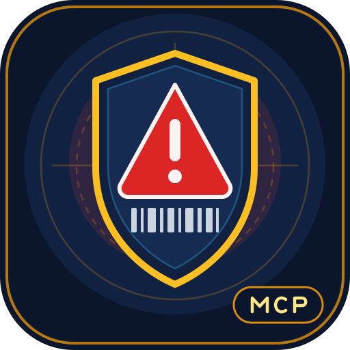

# US Product, Vehicle, Food & Drug Recalls Scraper (CPSC, FDA)

**Category:** E-Commerce Trust & Safety, Supply Chain Compliance & Legal Tech  
**Apify Store:** [https://apify.com/desastreger/cpsc-consumer-product-recall-monitor](https://apify.com/desastreger/cpsc-consumer-product-recall-monitor)  
**1-Click OAuth MCP (Zero API Key):** `https://mcp.apify.com/?tools=desastreger/cpsc-consumer-product-recall-monitor`  
**Direct Standby MCP (Bearer Token):** `https://desastreger--cpsc-consumer-product-recall-monitor.apify.actor/mcp`  
**Official Data Sources:** US CPSC SaferProducts Recall API (`saferproducts.gov`), US NHTSA Vehicle Recalls API (`api.nhtsa.gov`), & openFDA Food/Drug Enforcement API (`api.fda.gov`)

> [!IMPORTANT]
> **Early-Adopter Launch Pricing:** **$0.50 / 1k records** (`$0.0005`/record) — promotional launch pricing for early Store adopters & MCP integrations. Zero external CPSC, NHTSA, or FDA API keys or proxies required.

## Overview

Unifies three official US Federal Recall feeds into a single normalized schema (`17 U.S.C. § 105` public domain) with deterministic `0–100` `recallSeverityScore` and `severityTier` (`CRITICAL`, `HIGH`, `MODERATE`, `LOW`):

1. **CPSC SaferProducts:** Consumer product recalls, UPCs, model numbers, retailers (Amazon, Walmart, Target, Costco), hazards, injuries, and remedies.
2. **NHTSA Vehicle & Equipment Recalls:** Automotive recalls by `make`/`model`/`modelYear` or `campaignNumber` with `DO_NOT_DRIVE` and `PARK_OUTSIDE` life-safety flags.
3. **openFDA Food & Drug Enforcement:** Class I / II / III food and drug recalls with recalling firms, lot/NDC/UPC codes, and distribution patterns.

- **Zero External API Keys:** Runs 100% deterministically against official federal recall endpoints.
- **Dual Mode:** Call live over MCP (`Streamable HTTP`) from Claude, Cursor, Windsurf, VS Code, or Google Antigravity, OR run daily Slack compliance alerts via [Apify Store](https://apify.com/desastreger/cpsc-consumer-product-recall-monitor) and [`templates/n8n/cpsc-fda-product-recall-slack-alert.json`](../../templates/n8n/cpsc-fda-product-recall-slack-alert.json).

---

## MCP Tool Schemas

### `search_cpsc_product_recalls`

Search official US CPSC SaferProducts consumer product recalls by keyword, retailer (Amazon, Walmart, Target, Costco), lookback window (`daysBack`), and minimum severity score. Returns normalized UPCs, models, retailers, hazards, injuries, remedies, and `0-100` `recallSeverityScore`.

| Parameter | Type | Description |
| :--- | :--- | :--- |
| `query` | `string` | Optional keyword filter across product name, description, hazard, or manufacturer (e.g., `"lithium"`, `"magnet"`, `"bouncer"`). |
| `retailer` | `string` | Optional retailer or marketplace channel filter (e.g., `"Amazon"`, `"Walmart"`, `"Target"`, `"Costco"`). |
| `daysBack` | `integer` | Lookback window in days (`1-3650`). Default: `30`. |
| `minSeverityScore` | `integer` | Optional minimum `recallSeverityScore` (`0-100`). Default: `0`. |
| `maxResults` | `integer` | Maximum recall alerts to return (`1-50` in MCP mode). Default: `10`. |

### `check_nhtsa_vehicle_recalls`

Check official US NHTSA Vehicle & Equipment Recalls by `make`/`model`/`modelYear` or NHTSA `campaignNumber`. Returns `parkOutSide` / `DO_NOT_DRIVE` flags, affected components, crash/fire consequences, dealer remedies, and `0-100` `recallSeverityScore`.

| Parameter | Type | Description |
| :--- | :--- | :--- |
| `make` | `string` | Vehicle make (e.g., `"Toyota"`, `"Ford"`, `"Tesla"`). Pair with `model` and `modelYear`. |
| `model` | `string` | Vehicle model (e.g., `"Camry"`, `"F-150"`, `"Model Y"`). |
| `modelYear` | `integer` | Vehicle model year (e.g., `2023`). |
| `campaignNumber` | `string` | Official NHTSA recall campaign number (e.g., `"23V432000"`, `"24V854000"`). |
| `maxResults` | `integer` | Maximum NHTSA recalls to return (`1-50`). Default: `10`. |

### `search_fda_enforcement_recalls`

Search official openFDA Food & Drug Enforcement recalls (Class I / II / III) by `productType` (`"food"`, `"drug"`, or `"both"`), keyword `query`, `retailer`/distribution channel, FDA `classification`, and `daysBack`. Handles 0-match queries cleanly and returns normalized UPCs/NDCs, recalling firms, and `0-100` severity scores.

| Parameter | Type | Description |
| :--- | :--- | :--- |
| `productType` | `string` | openFDA enforcement feed to query: `"food"`, `"drug"`, or `"both"`. Default: `"both"`. |
| `query` | `string` | Optional keyword filter across `reason_for_recall`, `product_description`, `recalling_firm`, or lot codes (e.g., `"salmonella"`, `"undeclared"`, `"acetaminophen"`). |
| `retailer` | `string` | Optional retailer or distribution pattern filter (e.g., `"Walmart"`, `"Costco"`, `"nationwide"`). |
| `classification` | `string` | Optional FDA hazard classification filter (`"Class I"`, `"Class II"`, `"Class III"`). |
| `daysBack` | `integer` | Report date lookback window in days (`1-3650`). Default: `30`. |
| `maxResults` | `integer` | Maximum FDA enforcement recalls to return (`1-50`). Default: `10`. |

---

## Sample Output JSON

```json
{
  "agency": "CPSC",
  "recallId": "27096",
  "recallDate": "2026-11-19",
  "title": "CHE-US Recalls Magnetic Robot Toys Due to Risk of Serious Injury or Death from Magnet Ingestion; Violate Mandatory Standard for Toys",
  "productSummary": "This recall involves CHE-US magnetic stick figure toys. The robot-shaped toys were sold in sets of five or 10 purple, blue, yellow, red and green stick figures.",
  "recallingFirmOrManufacturer": "CHE-US",
  "retailersSoldAt": ["Amazon.com", "Amazon"],
  "upcsOrCodes": [],
  "hazardSummary": "The recalled magnetic stick figures violate the mandatory standard for toys because when pulled apart, the figures' arms and legs liberate high-powered magnets posing an ingestion hazard to children.",
  "injuriesOrIncidents": "None reported.",
  "classificationOrParkOutside": "MANDATORY_STANDARD_VIOLATION",
  "remedySummary": "Consumers should stop using the stick figures immediately, take them away from children and contact CHE-US for a full refund.",
  "unitsAffected": "About 101,282",
  "status": "Active",
  "sourceUrl": "https://cpsc.gov/Recalls/2027/CHE-US-Recalls-Magnetic-Robot-Toys-Due-to-Risk-of-Serious-Injury-or-Death-from-Magnet-Ingestion-Violate-Mandatory-Standard-for-Toys",
  "recallSeverityScore": 80,
  "severityTier": "CRITICAL"
}
```

---

## Quickstart

### Option 1: 1-Click Browser OAuth (Zero API Key Setup)

Connect directly via Apify's managed OAuth MCP gateway — your AI client opens a browser login once and requires **no manual `APIFY_TOKEN`** in config files:

```bash
# Claude Code CLI (1-Click OAuth)
claude mcp add --transport http cpsc-consumer-product-recall-monitor "https://mcp.apify.com/?tools=desastreger/cpsc-consumer-product-recall-monitor"
```

**Claude Desktop / Cursor / Windsurf / Google Antigravity (`mcp_config.json`):**
```json
{
  "mcpServers": {
    "cpsc-consumer-product-recall-monitor": {
      "url": "https://mcp.apify.com/?tools=desastreger/cpsc-consumer-product-recall-monitor"
    }
  }
}
```

**VS Code Copilot (`.vscode/mcp.json`):**
```json
{
  "servers": {
    "cpsc-consumer-product-recall-monitor": {
      "type": "http",
      "url": "https://mcp.apify.com/?tools=desastreger/cpsc-consumer-product-recall-monitor"
    }
  }
}
```

### Option 2: Direct Standby Streamable HTTP (`Bearer $APIFY_TOKEN`)

For headless automation, CI/CD, or direct token-authenticated clients:

```json
{
  "mcpServers": {
    "cpsc-consumer-product-recall-monitor": {
      "url": "https://desastreger--cpsc-consumer-product-recall-monitor.apify.actor/mcp",
      "headers": {
        "Authorization": "Bearer <YOUR_APIFY_TOKEN>"
      }
    }
  }
}
```

### cURL (`tools/call`)

```bash
curl -sS -X POST "https://desastreger--cpsc-consumer-product-recall-monitor.apify.actor/mcp" \
  -H "Authorization: Bearer <YOUR_APIFY_TOKEN>" \
  -H "Content-Type: application/json" \
  -H "Accept: application/json, text/event-stream" \
  -d '{"jsonrpc":"2.0","id":1,"method":"tools/call","params":{"name":"search_cpsc_product_recalls","arguments":{"retailer":"Amazon","daysBack":30,"maxResults":10}}}'
```

### JavaScript (`apify-client`)

```js
import { ApifyClient } from 'apify-client';

const client = new ApifyClient({ token: process.env.APIFY_TOKEN });
const run = await client.actor('desastreger/cpsc-consumer-product-recall-monitor').call({
  sources: ['cpsc', 'fda_food', 'fda_drug'],
  retailer: 'Amazon',
  daysBack: 30,
  maxResults: 25,
});
const { items } = await client.dataset(run.defaultDatasetId).listItems();
console.log(items);
```

### Python (`apify-client`)

```python
import os
from apify_client import ApifyClient

client = ApifyClient(os.environ["APIFY_TOKEN"])
run = client.actor("desastreger/cpsc-consumer-product-recall-monitor").call(
    run_input={
        "sources": ["cpsc", "nhtsa"],
        "vehicleMake": "Toyota",
        "vehicleModel": "Camry",
        "vehicleYear": 2023,
        "daysBack": 30,
        "maxResults": 10,
    }
)
print(client.dataset(run["defaultDatasetId"]).list_items().items)
```

---

[← Back to All 20 Open Data MCP Servers](../../README.md) · [Open on Apify Store →](https://apify.com/desastreger/cpsc-consumer-product-recall-monitor)
