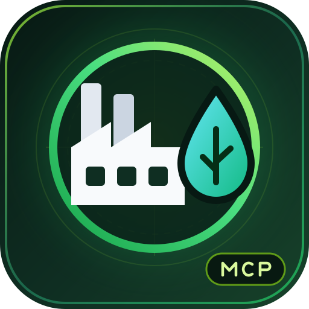

# EPA ECHO Scraper — Violations & Penalties ($0.50/1k)

**Category:** Environmental Compliance & ESG  
**Apify Store:** [https://apify.com/desastreger/epa-echo-industrial-facility-compliance](https://apify.com/desastreger/epa-echo-industrial-facility-compliance)  
**1-Click OAuth MCP (Zero API Key):** `https://mcp.apify.com/?tools=desastreger/epa-echo-industrial-facility-compliance`  
**Direct Standby MCP (Bearer Token):** `https://desastreger--epa-echo-industrial-facility-compliance.apify.actor/mcp`  
**Official Data Sources:** US EPA ECHO REST APIs (Clean Water NPDES, Clean Air, RCRA)

> [!IMPORTANT]
> **Early-Adopter Launch Pricing:** **$0.50 / 1k records** (`$0.0005`/record) — promotional launch pricing while early adopters onboard. Scheduled to step up to our standard **$1.50 / 1k records** (`$0.0015`/record) rate after the launch window, still **75%–95% cheaper** than comparable Store scrapers.

## Overview

Screen US industrial plants, refineries, and utilities via US EPA ECHO APIs for Clean Water Act (NPDES), Clean Air Act, and RCRA Hazardous Waste Significant Non-Compliance (SNC/HPV) flags, inspections, and civil penalties.

- **Zero External API Keys:** Runs 100% deterministically against public-domain government APIs and RFC protocols.
- **Dual Mode:** Call live over MCP (`Streamable HTTP`) from Claude, Cursor, Windsurf, VS Code, or Google Antigravity, OR run batch jobs on [Apify Store](https://apify.com/desastreger/epa-echo-industrial-facility-compliance).

---

## MCP Tool Schemas

### `search_epa_facility_violations`

Screen US industrial facilities, manufacturing plants, refineries, and utilities for Clean Water Act (NPDES), Clean Air Act, and RCRA hazardous waste violations, SNC/HPV flags, inspections, and civil penalties via official US EPA ECHO REST APIs.

| Parameter | Type | Description |
| :--- | :--- | :--- |
| `programs` | `array` | EPA statute programs to query: "cwa" (Clean Water Act NPDES), "air" (Clean Air Act), "rcra" (RCRA Hazardous Waste). Default: ["cwa", "air"]. |
| `states` | `array` | 2-letter US state codes (e.g., ["DE"], ["TX", "LA"]). Default: ["DE"]. |
| `violationsOnly` | `boolean` | Return only facilities with violations, SNC/HPV flags, formal enforcement actions, or penalties. Default: true. |
| `facilityName` | `string` | Optional partial or exact facility/company name filter. |
| `city` | `string` | Optional city name filter. |
| `naicsCode` | `string` | Optional 2-to-6 digit NAICS industry code prefix (e.g., "325"). |
| `minPenaltyUsd` | `number` | Minimum total formal enforcement civil penalties in USD. Default: 0. |
| `maxResults` | `integer` | Maximum facility records to return (1-50 in MCP mode). Default: 10. |

### `lookup_facility_compliance`

Look up cross-statute US EPA compliance history, permits, inspections, SNC status, and penalties for a specific facility by EPA FRS Registry ID, source permit ID (NPDES/AIR/RCRA), or facility name.

| Parameter | Type | Description |
| :--- | :--- | :--- |
| `registryId` | `string` | EPA FRS 12-digit Registry ID (e.g., "110000338652"). |
| `sourcePermitId` | `string` | Program-specific NPDES, CAA, or RCRA source permit ID (e.g., "DE0000299"). |
| `facilityName` | `string` | Facility or company name when Registry ID / Permit ID is unknown. |
| `state` | `string` | Optional 2-letter US state code to scope facilityName lookups (e.g., "DE"). |
| `city` | `string` | Optional city filter for facilityName lookups. |
| `programs` | `array` | Statute programs to check for this facility. Default: ["cwa", "air", "rcra"]. |
| `violationsOnly` | `boolean` | When false (default for lookup), returns both clean and non-compliant permits held by the facility. |
| `maxResults` | `integer` | Maximum permit compliance records to return (1-50). Default: 10. |

---

## Sample Output JSON

```json
{
  "facilityName": "CRODA, INC",
  "sourcePermitId": "DE0000001000300058",
  "epaRegistryId": "110000338652",
  "statuteProgram": "CLEAN_AIR_ACT",
  "city": "NEW CASTLE",
  "state": "DE",
  "inSignificantNonCompliance": true,
  "quartersInNonCompliance": 12,
  "inspectionsCount": 249,
  "complianceRiskScore": 88,
  "riskTier": "CRITICAL"
}
```

---

## Quickstart

### Option 1: 1-Click Browser OAuth (Zero API Key Setup)

Connect directly via Apify's managed OAuth MCP gateway — your AI client opens a browser login once and requires **no manual `APIFY_TOKEN`** in config files:

```bash
# Claude Code CLI (1-Click OAuth)
claude mcp add --transport http epa-echo-industrial-facility-compliance "https://mcp.apify.com/?tools=desastreger/epa-echo-industrial-facility-compliance"
```

**Claude Desktop / Cursor / Windsurf / Google Antigravity (`mcp_config.json`):**
```json
{
  "mcpServers": {
    "epa-echo-industrial-facility-compliance": {
      "url": "https://mcp.apify.com/?tools=desastreger/epa-echo-industrial-facility-compliance"
    }
  }
}
```

**VS Code Copilot (`.vscode/mcp.json`):**
```json
{
  "servers": {
    "epa-echo-industrial-facility-compliance": {
      "type": "http",
      "url": "https://mcp.apify.com/?tools=desastreger/epa-echo-industrial-facility-compliance"
    }
  }
}
```

### Option 2: Direct Standby Streamable HTTP (`Bearer $APIFY_TOKEN`)

For headless automation, CI/CD, or direct token-authenticated clients:

```json
{
  "mcpServers": {
    "epa-echo-industrial-facility-compliance": {
      "url": "https://desastreger--epa-echo-industrial-facility-compliance.apify.actor/mcp",
      "headers": {
        "Authorization": "Bearer <YOUR_APIFY_TOKEN>"
      }
    }
  }
}
```

### cURL (`tools/call`)

```bash
curl -sS -X POST "https://desastreger--epa-echo-industrial-facility-compliance.apify.actor/mcp" \
  -H "Authorization: Bearer <YOUR_APIFY_TOKEN>" \
  -H "Content-Type: application/json" \
  -H "Accept: application/json, text/event-stream" \
  -d '{"jsonrpc":"2.0","id":1,"method":"tools/call","params":{"name":"search_epa_facility_violations","arguments":{"programs":["cwa","air"],"states":["DE"],"violationsOnly":true,"maxResults":5}}}'
```

### JavaScript (`apify-client`)

```js
import { ApifyClient } from 'apify-client';

const client = new ApifyClient({ token: process.env.APIFY_TOKEN });
const run = await client.actor('desastreger/epa-echo-industrial-facility-compliance').call({
  "programs": [
    "cwa",
    "air"
  ],
  "states": [
    "DE"
  ],
  "violationsOnly": true,
  "maxResults": 5
});
const { items } = await client.dataset(run.defaultDatasetId).listItems();
console.log(items);
```

### Python (`apify-client`)

```python
import os
from apify_client import ApifyClient

client = ApifyClient(os.environ["APIFY_TOKEN"])
run = client.actor("desastreger/epa-echo-industrial-facility-compliance").call(run_input={"programs":["cwa","air"],"states":["DE"],"violationsOnly":true,"maxResults":5})
print(client.dataset(run["defaultDatasetId"]).list_items().items)
```

---

[← Back to All 10 Open Data MCP Servers](../../README.md) · [Open on Apify Store →](https://apify.com/desastreger/epa-echo-industrial-facility-compliance)
