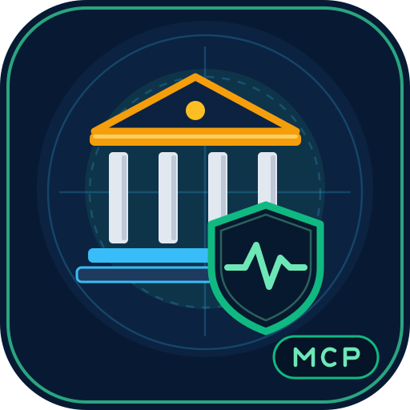

# FDIC Bank Financial Health, Call Reports & Risk Screener

**Category:** Banking Risk, Corporate Treasury & FinTech Compliance  
**Apify Store:** [https://apify.com/desastreger/fdic-bank-financial-health-screener](https://apify.com/desastreger/fdic-bank-financial-health-screener)  
**1-Click OAuth MCP (Zero API Key):** `https://mcp.apify.com/?tools=desastreger/fdic-bank-financial-health-screener`  
**Direct Standby MCP (Bearer Token):** `https://desastreger--fdic-bank-financial-health-screener.apify.actor/mcp`  
**Official Data Sources:** FDIC BankFind Suite REST API (`banks.data.fdic.gov/api` — Institutions, Call Report Financials, Failures) & CFPB Consumer Complaint Database

> [!IMPORTANT]
> **Early-Adopter Launch Pricing:** **$0.80 / 1k records** (`$0.0008`/record) — promotional launch pricing for early Store adopters & MCP integrations. Zero external FDIC or CFPB API keys or proxies required.

## Overview

Screen **US FDIC-insured banks and savings associations** directly against the official **FDIC BankFind Suite REST API** (`17 U.S.C. § 105` public domain) enriched with **CFPB Consumer Complaint Database** counts. Extracts Call Report assets, deposits, equity, and net income (normalized in both `$k` and USD), Tier 1 Leverage Ratio (`RBC1AAJ`), `ROA`, `ROE`, non-current loan ratio (`NCLNLS / LNLSNET`), FDIC bank failure history, deterministic `0–100` `bankHealthScore`, and `riskTier` (`STRONG`, `SATISFACTORY`, `WATCH`, `ELEVATED_RISK`, `FAILED_BANK`).

- **Zero External API Keys:** Runs 100% deterministically against official FDIC BankFind and CFPB endpoints.
- **Dual Mode:** Call live over MCP (`Streamable HTTP`) from Claude, Cursor, Windsurf, VS Code, or Google Antigravity, OR run automated treasury counterparty checks via [Apify Store](https://apify.com/desastreger/fdic-bank-financial-health-screener) and [`templates/n8n/fdic-bank-counterparty-risk-monitor.json`](../../templates/n8n/fdic-bank-counterparty-risk-monitor.json).

---

## MCP Tool Schemas

### `screen_us_bank_health`

Screen US FDIC-insured banks via official FDIC BankFind Suite REST API (institutions, latest Call Report financials, failure registry) and CFPB Consumer Complaint Database. Returns normalized assets/deposits/equity in `$k` and USD, Tier 1 leverage (`RBC1AAJ`), ROA/ROE, non-current loan ratio, CFPB complaint count, deterministic `0-100` `bankHealthScore`, and `riskTier`.

| Parameter | Type | Description |
| :--- | :--- | :--- |
| `bankNames` | `array` | Optional bank names to screen (e.g., `["JPMorgan Chase", "Cross River", "Evolve Bank"]`). Leave empty to pull largest active banks matching state/asset filters. |
| `certNumbers` | `array` | Optional FDIC Certificate Numbers (e.g., `["628", "58410", "1299"]`). |
| `states` | `array` | Optional 2-letter US state codes (e.g., `["CA", "NY", "NJ"]`). |
| `minAssetsMillions` | `integer` | Optional minimum total assets in USD millions (e.g., `1000` for `$1B+`). Default: `0`. |
| `activeOnly` | `boolean` | Restrict to active FDIC charters (`true`) or include closed/failed banks (`false`). Default: `true`. |
| `includeFailureHistory` | `boolean` | Cross-check FDIC failure registry for closed/CERT matches. Default: `true`. |
| `includeCfpbComplaints` | `boolean` | Include total CFPB complaint volume and latest 3 complaints. Default: `true`. |
| `sortBy` | `string` | Sort order for returned banks (`"ASSET"`, `"BANK_HEALTH_SCORE"`, `"ROA"`). Default: `"ASSET"`. |
| `maxResults` | `integer` | Maximum banks to return (`1-50` in MCP mode). Default: `5`. |

### `search_fdic_bank_failures`

Search the official FDIC Bank Failures & Assistance Transactions registry (`/api/failures`) by bank name, FDIC CERT number, state, or failure year range. Returns failure dates, resolution type (`RESTYPE`), insurance fund (`DIF`/`BIF`/`SAIF`), assets/deposits at failure, and estimated DIF loss cost.

| Parameter | Type | Description |
| :--- | :--- | :--- |
| `bankName` | `string` | Optional failed bank name search term (e.g., `"Silicon Valley"`, `"First Republic"`, `"Signature"`). |
| `certNumber` | `string` | Optional exact FDIC CERT number (e.g., `"24735"`). |
| `states` | `array` | Optional 2-letter state codes (e.g., `["CA", "NY"]`). |
| `startYear` | `integer` | Optional earliest failure year (e.g., `2023`). |
| `endYear` | `integer` | Optional latest failure year (e.g., `2026`). |
| `includeCfpbComplaints` | `boolean` | Optionally enrich with CFPB consumer complaint history. Default: `false`. |
| `maxResults` | `integer` | Maximum failure records to return (`1-50`). Default: `10`. |

### `compare_bank_financial_ratios`

Compare 2 or more US FDIC-insured banks side-by-side across Call Report capital adequacy (Tier 1 leverage `RBC1AAJ`, equity/assets), profitability (`ROA`, `ROE`), asset quality (non-current loan ratio), CFPB complaint counts, and `0-100` `bankHealthScore` for sponsor-bank or treasury counterparty selection.

| Parameter | Type | Description |
| :--- | :--- | :--- |
| `bankNames` | `array` | List of bank names to compare (e.g., `["Cross River", "Evolve Bank", "JPMorgan Chase"]`). |
| `certNumbers` | `array` | Optional list of exact FDIC CERT numbers to compare (e.g., `["58410", "1299", "628"]`). |
| `includeCfpbComplaints` | `boolean` | Include CFPB complaint counts in comparison. Default: `true`. |

---

## Sample Output JSON

```json
{
  "recordType": "INSTITUTION_HEALTH",
  "cert": 628,
  "fedRssd": "852218",
  "name": "JPMorgan Chase Bank, National Association",
  "city": "Columbus",
  "state": "OH",
  "zip": "43240",
  "website": "https://www.jpmorganchase.com",
  "active": true,
  "charterClass": "N",
  "charterClassLabel": "National Bank (OCC)",
  "callReportDate": "2026-09-30",
  "totalAssetsThousandsUsd": 4174631000,
  "totalAssetsUsd": 4174631000000,
  "totalDepositsThousandsUsd": 2901316000,
  "totalDepositsUsd": 2901316000000,
  "totalEquityThousandsUsd": 331583000,
  "totalEquityUsd": 331583000000,
  "netIncomeThousandsUsd": 44485000,
  "netIncomeUsd": 44485000000,
  "roaPercent": 1.48,
  "roePercent": 17.64,
  "tier1LeverageRatioPercent": 7.24,
  "equityToAssetsPercent": 7.94,
  "nonCurrentLoanRatioPercent": 0.77,
  "depositsToAssetsPercent": 69.5,
  "cfpbComplaintsTotal": 181407,
  "failedBank": false,
  "failureDate": null,
  "bankHealthScore": 89,
  "riskTier": "STRONG",
  "fdicProfileUrl": "https://banks.data.fdic.gov/bankfind-suite/bankfind?activeStatus=0%20OR%201&cert=628"
}
```

---

## Quickstart

### Option 1: 1-Click Browser OAuth (Zero API Key Setup)

Connect directly via Apify's managed OAuth MCP gateway — your AI client opens a browser login once and requires **no manual `APIFY_TOKEN`** in config files:

```bash
# Claude Code CLI (1-Click OAuth)
claude mcp add --transport http fdic-bank-financial-health-screener "https://mcp.apify.com/?tools=desastreger/fdic-bank-financial-health-screener"
```

**Claude Desktop / Cursor / Windsurf / Google Antigravity (`mcp_config.json`):**
```json
{
  "mcpServers": {
    "fdic-bank-financial-health-screener": {
      "url": "https://mcp.apify.com/?tools=desastreger/fdic-bank-financial-health-screener"
    }
  }
}
```

**VS Code Copilot (`.vscode/mcp.json`):**
```json
{
  "servers": {
    "fdic-bank-financial-health-screener": {
      "type": "http",
      "url": "https://mcp.apify.com/?tools=desastreger/fdic-bank-financial-health-screener"
    }
  }
}
```

### Option 2: Direct Standby Streamable HTTP (`Bearer $APIFY_TOKEN`)

For headless automation, CI/CD, or direct token-authenticated clients:

```json
{
  "mcpServers": {
    "fdic-bank-financial-health-screener": {
      "url": "https://desastreger--fdic-bank-financial-health-screener.apify.actor/mcp",
      "headers": {
        "Authorization": "Bearer <YOUR_APIFY_TOKEN>"
      }
    }
  }
}
```

### cURL (`tools/call`)

```bash
curl -sS -X POST "https://desastreger--fdic-bank-financial-health-screener.apify.actor/mcp" \
  -H "Authorization: Bearer <YOUR_APIFY_TOKEN>" \
  -H "Content-Type: application/json" \
  -H "Accept: application/json, text/event-stream" \
  -d '{"jsonrpc":"2.0","id":1,"method":"tools/call","params":{"name":"screen_us_bank_health","arguments":{"bankNames":["JPMorgan Chase","Cross River"],"maxResults":5}}}'
```

### JavaScript (`apify-client`)

```js
import { ApifyClient } from 'apify-client';

const client = new ApifyClient({ token: process.env.APIFY_TOKEN });
const run = await client.actor('desastreger/fdic-bank-financial-health-screener').call({
  mode: 'screen',
  certNumbers: ['628', '58410', '1299'],
  includeCfpbComplaints: true,
  maxResults: 10,
});
const { items } = await client.dataset(run.defaultDatasetId).listItems();
console.log(items);
```

### Python (`apify-client`)

```python
import os
from apify_client import ApifyClient

client = ApifyClient(os.environ["APIFY_TOKEN"])
run = client.actor("desastreger/fdic-bank-financial-health-screener").call(
    run_input={
        "mode": "failures",
        "states": ["CA", "NY"],
        "startYear": 2023,
        "maxResults": 10,
    }
)
print(client.dataset(run["defaultDatasetId"]).list_items().items)
```

---

[← Back to All 20 Open Data MCP Servers](../../README.md) · [Open on Apify Store →](https://apify.com/desastreger/fdic-bank-financial-health-screener)
