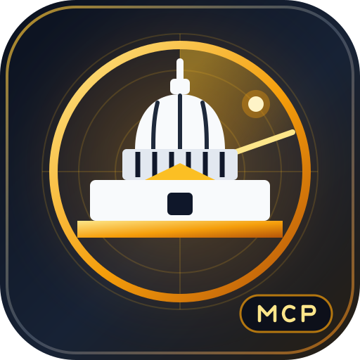

# GovCon Recompete Contracts & Grants Scraper ($0.80/1k)

**Category:** Government Contracting & Grants  
**Apify Store:** [https://apify.com/desastreger/federal-govcon-recompete-radar](https://apify.com/desastreger/federal-govcon-recompete-radar)  
**1-Click OAuth MCP (Zero API Key):** `https://mcp.apify.com/?tools=desastreger/federal-govcon-recompete-radar`  
**Direct Standby MCP (Bearer Token):** `https://desastreger--federal-govcon-recompete-radar.apify.actor/mcp`  
**Official Data Sources:** USASpending.gov, Grants.gov

> [!IMPORTANT]
> **Early-Adopter Launch Pricing:** **$0.80 / 1k records** (`$0.0008`/record) — promotional launch pricing while early adopters onboard. Scheduled to step up to our standard **$2.00 / 1k records** (`$0.002`/record) rate after the launch window, still **75%–95% cheaper** than comparable Store scrapers.

## Overview

Track expiring US federal contracts entering recompete windows (USASpending.gov) and live open/forecasted federal grants (Grants.gov) with incumbent vendor names, UEIs, obligated ceiling values, NAICS/PSC codes, and expiration countdowns.

- **Zero External API Keys:** Runs 100% deterministically against public-domain government APIs and RFC protocols.
- **Dual Mode:** Call live over MCP (`Streamable HTTP`) from Claude, Cursor, Windsurf, VS Code, or Google Antigravity, OR run batch jobs on [Apify Store](https://apify.com/desastreger/federal-govcon-recompete-radar).

---

## MCP Tool Schemas

### `search_expiring_recompete_contracts`

Search active US federal contracts (USASpending.gov) expiring within the next N days to identify incumbent recompete capture opportunities, incumbent vendor names, obligated contract values, NAICS codes, and awarding agencies.

| Parameter | Type | Description |
| :--- | :--- | :--- |
| `keywords` | `array` | Optional domain keywords (e.g., ["cybersecurity", "cloud migration"]). |
| `naicsCodes` | `array` | Optional 6-digit NAICS codes (e.g., ["541512", "541511"]). |
| `expiringWithinDays` | `integer` | Days ahead from today for Period of Performance End Date (1-1095). Default: 180. |
| `minAwardAmount` | `number` | Minimum contract award value in USD. Default: 50000. |
| `states` | `array` | Optional 2-letter US Place of Performance state codes (e.g., ["VA", "MD", "DC"]). |
| `sortBy` | `string` | Sort by highest contract value ("amount_desc") or soonest expiration ("expiration_asc"). |
| `maxResults` | `integer` | Maximum recompete contracts to return (1-50 in MCP mode). Default: 10. |

### `search_open_federal_grants`

Search live open ("posted") and upcoming ("forecasted") US federal grant & R&D funding opportunities directly from official Grants.gov APIs.

| Parameter | Type | Description |
| :--- | :--- | :--- |
| `keywords` | `array` | Optional topic keywords (e.g., ["artificial intelligence", "quantum"]). |
| `keyword` | `string` | Optional single keyword string query (alias merged with keywords). |
| `agencies` | `array` | Optional federal agency codes filter (e.g., ["DOD", "NSF", "HHS", "DOE"]). |
| `oppStatuses` | `string` | Pipe-delimited Grants.gov statuses. Default: "forecasted\|posted". |
| `maxResults` | `integer` | Maximum grant opportunities to return (1-50 in MCP mode). Default: 10. |

---

## Sample Output JSON

```json
{
  "recordType": "RECOMPETE_CONTRACT",
  "opportunityOrAwardId": "FA862118F6251",
  "titleOrDescription": "CYBERSECURITY AND MISSION SYSTEMS ENGINEERING SUPPORT",
  "agency": "Department of Defense",
  "incumbentVendor": "LOCKHEED MARTIN CORPORATION",
  "amountUsd": 666315748.84,
  "endDateOrCloseDate": "2027-01-31",
  "daysUntilExpiration": 81,
  "naicsCode": "541512",
  "placeOfPerformanceState": "VA"
}
```

---

## Quickstart

### Option 1: 1-Click Browser OAuth (Zero API Key Setup)

Connect directly via Apify's managed OAuth MCP gateway — your AI client opens a browser login once and requires **no manual `APIFY_TOKEN`** in config files:

```bash
# Claude Code CLI (1-Click OAuth)
claude mcp add --transport http federal-govcon-recompete-radar "https://mcp.apify.com/?tools=desastreger/federal-govcon-recompete-radar"
```

**Claude Desktop / Cursor / Windsurf / Google Antigravity (`mcp_config.json`):**
```json
{
  "mcpServers": {
    "federal-govcon-recompete-radar": {
      "url": "https://mcp.apify.com/?tools=desastreger/federal-govcon-recompete-radar"
    }
  }
}
```

**VS Code Copilot (`.vscode/mcp.json`):**
```json
{
  "servers": {
    "federal-govcon-recompete-radar": {
      "type": "http",
      "url": "https://mcp.apify.com/?tools=desastreger/federal-govcon-recompete-radar"
    }
  }
}
```

### Option 2: Direct Standby Streamable HTTP (`Bearer $APIFY_TOKEN`)

For headless automation, CI/CD, or direct token-authenticated clients:

```json
{
  "mcpServers": {
    "federal-govcon-recompete-radar": {
      "url": "https://desastreger--federal-govcon-recompete-radar.apify.actor/mcp",
      "headers": {
        "Authorization": "Bearer <YOUR_APIFY_TOKEN>"
      }
    }
  }
}
```

### cURL (`tools/call`)

```bash
curl -sS -X POST "https://desastreger--federal-govcon-recompete-radar.apify.actor/mcp" \
  -H "Authorization: Bearer <YOUR_APIFY_TOKEN>" \
  -H "Content-Type: application/json" \
  -H "Accept: application/json, text/event-stream" \
  -d '{"jsonrpc":"2.0","id":1,"method":"tools/call","params":{"name":"search_expiring_recompete_contracts","arguments":{"mode":"all","keywords":["cybersecurity"],"expiringWithinDays":180,"minAwardAmount":50000,"maxResults":5}}}'
```

### JavaScript (`apify-client`)

```js
import { ApifyClient } from 'apify-client';

const client = new ApifyClient({ token: process.env.APIFY_TOKEN });
const run = await client.actor('desastreger/federal-govcon-recompete-radar').call({
  "mode": "all",
  "keywords": [
    "cybersecurity"
  ],
  "expiringWithinDays": 180,
  "minAwardAmount": 50000,
  "maxResults": 5
});
const { items } = await client.dataset(run.defaultDatasetId).listItems();
console.log(items);
```

### Python (`apify-client`)

```python
import os
from apify_client import ApifyClient

client = ApifyClient(os.environ["APIFY_TOKEN"])
run = client.actor("desastreger/federal-govcon-recompete-radar").call(run_input={"mode":"all","keywords":["cybersecurity"],"expiringWithinDays":180,"minAwardAmount":50000,"maxResults":5})
print(client.dataset(run["defaultDatasetId"]).list_items().items)
```

---

[← Back to All 10 Open Data MCP Servers](../../README.md) · [Open on Apify Store →](https://apify.com/desastreger/federal-govcon-recompete-radar)
