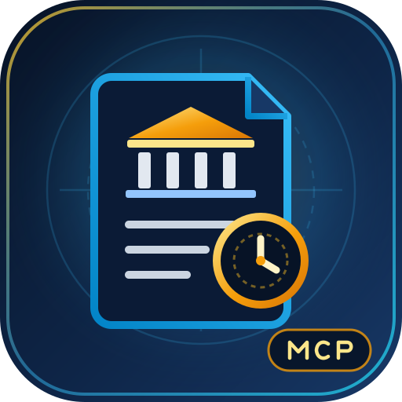

# US Federal Register Rules, Notices & Executive Orders Scraper

**Category:** Regulatory Compliance, Legal Tech & Government Affairs  
**Apify Store:** [https://apify.com/desastreger/federal-register-regulatory-rule-radar](https://apify.com/desastreger/federal-register-regulatory-rule-radar)  
**1-Click OAuth MCP (Zero API Key):** `https://mcp.apify.com/?tools=desastreger/federal-register-regulatory-rule-radar`  
**Direct Standby MCP (Bearer Token):** `https://desastreger--federal-register-regulatory-rule-radar.apify.actor/mcp`  
**Official Data Sources:** US Office of the Federal Register REST API v1 (`federalregister.gov/api/v1`)

> [!IMPORTANT]
> **Early-Adopter Launch Pricing:** **$0.50 / 1k records** (`$0.0005`/record) — promotional launch pricing for early Store adopters & MCP integrations. Zero external Federal Register API keys or proxies required.

## Overview

Monitor newly published **US Federal Register Final Rules (`RULE`)**, **Proposed Rules (`PRORULE`)**, **Agency Notices (`NOTICE`)**, and **Presidential Executive Orders & Memoranda (`PRESDOCU`)** directly from the official **US Federal Register REST API v1** (`17 U.S.C. § 105` public domain). Automatically computes `daysUntilCommentsClose`, `daysUntilEffective`, deterministic `0–100` `regulatoryImpactScore`, and `urgencyTier` (`IMMEDIATE_EFFECTIVE`, `OPEN_COMMENT_DEADLINE`, `SIGNIFICANT_RULE`, `STANDARD`), alongside normalized CFR citations, docket IDs, RINs, and Regulations.gov comment counts.

- **Zero External API Keys:** Runs 100% deterministically against official `federalregister.gov` API v1 endpoints.
- **Dual Mode:** Call live over MCP (`Streamable HTTP`) from Claude, Cursor, Windsurf, VS Code, or Google Antigravity, OR run batch jobs / Slack deadline alerts via [Apify Store](https://apify.com/desastreger/federal-register-regulatory-rule-radar) and [`templates/n8n/federal-register-comment-deadline-slack.json`](../../templates/n8n/federal-register-comment-deadline-slack.json).

---

## MCP Tool Schemas

### `search_federal_register_rules`

Search newly published US Federal Register Final Rules, Proposed Rules, Notices, and Presidential Executive Orders via official `federalregister.gov` API v1. Returns normalized CFR citations, agencies, dockets, RINs, effective/comment countdowns, urgency tier, and 0-100 regulatory impact scores.

| Parameter | Type | Description |
| :--- | :--- | :--- |
| `query` | `string` | Optional full-text search term (e.g., `"artificial intelligence"`, `"PFAS"`, `"Medicare"`). |
| `documentTypes` | `array` | Federal Register document types to include (`"RULE"`, `"PRORULE"`, `"NOTICE"`, `"PRESDOCU"`). Default: `["RULE", "PRORULE", "PRESDOCU"]`. |
| `agencySlugs` | `array` | Optional Federal Register agency slugs (e.g., `["securities-and-exchange-commission", "environmental-protection-agency"]`). |
| `daysBack` | `integer` | Lookback window in days (1-3650); falls back to 60 days if 0 hits. Default: 14. |
| `openCommentWindowOnly` | `boolean` | Return only documents with an open public comment window. Default: false. |
| `significantOnly` | `boolean` | Filter to OMB economically/regulatorily significant rules. Default: false. |
| `maxResults` | `integer` | Maximum documents to return (1-50 in MCP mode). Default: 10. |

### `track_open_comment_deadlines`

Track US Federal Register Proposed Rules and Notices with active, open public comment windows (`comments_close_on >= today`), sorted by soonest closing deadline and regulatory impact score so legal and government-affairs teams never miss a comment cutoff.

| Parameter | Type | Description |
| :--- | :--- | :--- |
| `query` | `string` | Optional topic or industry keyword filter. |
| `agencySlugs` | `array` | Optional Federal Register agency slugs to monitor. |
| `documentTypes` | `array` | Document types to scan for open comments (`"RULE"`, `"PRORULE"`, `"NOTICE"`, `"PRESDOCU"`). Default: `["PRORULE", "NOTICE"]`. |
| `significantOnly` | `boolean` | Filter to OMB significant rulemakings only. Default: false. |
| `daysBack` | `integer` | Publication lookback window in days (1-3650). Default: 60. |
| `maxClosingInDays` | `integer` | Optional filter for deadlines closing within N days (e.g., `30` for deadlines closing in `<= 30` days). |
| `maxResults` | `integer` | Maximum open-comment rules to return (1-50). Default: 10. |

### `get_federal_register_document`

Look up a specific US Federal Register document by official document number (e.g., `"2026-24141"`) with full normalized CFR citations, agencies, dockets, RINs, comment counts, effective/comment countdowns, and regulatory impact score.

| Parameter | Type | Description |
| :--- | :--- | :--- |
| `documentNumber` | `string` | **Required.** Official Federal Register document number (e.g., `"2026-24141"`). |

---

## Sample Output JSON

```json
{
  "documentNumber": "2026-24141",
  "title": "Implementation of HAVANA Act of 2021; Correction",
  "documentType": "Rule",
  "documentTypeCode": "RULE",
  "subtype": null,
  "executiveOrderNumber": null,
  "publicationDate": "2026-11-27",
  "effectiveOn": "2026-11-27",
  "commentsCloseOn": null,
  "daysUntilEffective": 0,
  "daysUntilCommentsClose": null,
  "hasOpenCommentWindow": false,
  "significant": true,
  "priorityCategory": "Other Significant",
  "urgencyTier": "IMMEDIATE_EFFECTIVE",
  "regulatoryImpactScore": 69,
  "primaryAgency": "Justice Department",
  "primaryAgencySlug": "justice-department",
  "agencies": ["Justice Department"],
  "agencySlugs": ["justice-department"],
  "docketIds": ["JMD Docket No. 157", "A.G. Order No. 7256-2026"],
  "rins": ["1105-AB71"],
  "cfrReferences": ["28 CFR Part 106"],
  "cfrTitlesCount": 1,
  "regulationsGovDocketId": "DOJ_FRDOC_0001",
  "regulationsGovCommentsCount": 0,
  "regulationsGovCommentsUrl": "https://www.regulations.gov/docketBrowser?rpp=50&so=DESC&sb=postedDate&po=0&dct=PS&D=DOJ_FRDOC_0001",
  "abstract": "The Department of Justice corrects a final rule implementing the HAVANA Act of 2021.",
  "citation": null,
  "htmlUrl": "https://www.federalregister.gov/documents/2026/11/27/2026-24141/implementation-of-havana-act-of-2021-correction",
  "pdfUrl": "https://www.govinfo.gov/content/pkg/FR-2026-11-27/pdf/2026-24141.pdf"
}
```

---

## Quickstart

### Option 1: 1-Click Browser OAuth (Zero API Key Setup)

Connect directly via Apify's managed OAuth MCP gateway — your AI client opens a browser login once and requires **no manual `APIFY_TOKEN`** in config files:

```bash
# Claude Code CLI (1-Click OAuth)
claude mcp add --transport http federal-register-regulatory-rule-radar "https://mcp.apify.com/?tools=desastreger/federal-register-regulatory-rule-radar"
```

**Claude Desktop / Cursor / Windsurf / Google Antigravity (`mcp_config.json`):**
```json
{
  "mcpServers": {
    "federal-register-regulatory-rule-radar": {
      "url": "https://mcp.apify.com/?tools=desastreger/federal-register-regulatory-rule-radar"
    }
  }
}
```

**VS Code Copilot (`.vscode/mcp.json`):**
```json
{
  "servers": {
    "federal-register-regulatory-rule-radar": {
      "type": "http",
      "url": "https://mcp.apify.com/?tools=desastreger/federal-register-regulatory-rule-radar"
    }
  }
}
```

### Option 2: Direct Standby Streamable HTTP (`Bearer $APIFY_TOKEN`)

For headless automation, CI/CD, or direct token-authenticated clients:

```json
{
  "mcpServers": {
    "federal-register-regulatory-rule-radar": {
      "url": "https://desastreger--federal-register-regulatory-rule-radar.apify.actor/mcp",
      "headers": {
        "Authorization": "Bearer <YOUR_APIFY_TOKEN>"
      }
    }
  }
}
```

### cURL (`tools/call`)

```bash
curl -sS -X POST "https://desastreger--federal-register-regulatory-rule-radar.apify.actor/mcp" \
  -H "Authorization: Bearer <YOUR_APIFY_TOKEN>" \
  -H "Content-Type: application/json" \
  -H "Accept: application/json, text/event-stream" \
  -d '{"jsonrpc":"2.0","id":1,"method":"tools/call","params":{"name":"track_open_comment_deadlines","arguments":{"maxClosingInDays":30,"maxResults":10}}}'
```

### JavaScript (`apify-client`)

```js
import { ApifyClient } from 'apify-client';

const client = new ApifyClient({ token: process.env.APIFY_TOKEN });
const run = await client.actor('desastreger/federal-register-regulatory-rule-radar').call({
  documentTypes: ['PRORULE'],
  openCommentWindowOnly: true,
  daysBack: 30,
  maxResults: 25,
});
const { items } = await client.dataset(run.defaultDatasetId).listItems();
console.log(items);
```

### Python (`apify-client`)

```python
import os
from apify_client import ApifyClient

client = ApifyClient(os.environ["APIFY_TOKEN"])
run = client.actor("desastreger/federal-register-regulatory-rule-radar").call(
    run_input={
        "agencySlugs": ["environmental-protection-agency", "securities-and-exchange-commission"],
        "documentTypes": ["RULE", "PRORULE"],
        "daysBack": 30,
        "maxResults": 25,
    }
)
print(client.dataset(run["defaultDatasetId"]).list_items().items)
```

---

[← Back to All 17 Open Data MCP Servers](../../README.md) · [Open on Apify Store →](https://apify.com/desastreger/federal-register-regulatory-rule-radar)
