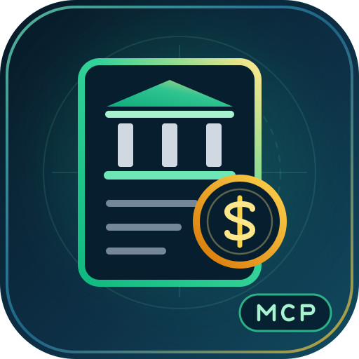

# IRS Form 990 Nonprofit & Foundation Grantmakers Scraper

**Category:** Nonprofit Financials & Philanthropy Lead Gen  
**Apify Store:** [https://apify.com/desastreger/irs-990-nonprofit-grantmaker-leads](https://apify.com/desastreger/irs-990-nonprofit-grantmaker-leads)  
**1-Click OAuth MCP (Zero API Key):** `https://mcp.apify.com/?tools=desastreger/irs-990-nonprofit-grantmaker-leads`  
**Direct Standby MCP (Bearer Token):** `https://desastreger--irs-990-nonprofit-grantmaker-leads.apify.actor/mcp`  
**Official Data Sources:** ProPublica Nonprofit Explorer API v2, IRS Exempt Organizations BMF, IRS Form 990 / 990-PF / 990-EZ

> [!IMPORTANT]
> **Early-Adopter Launch Pricing:** **$0.50 / 1k leads** (`$0.0005`/lead) — promotional launch pricing for early Store adopters & MCP integrations. Zero external API keys or proxies required.

## Overview

Extract verified financial intelligence, executive compensation, endowment/asset balances, and grantmaking activity for **US 501(c) nonprofits, hospitals, universities, and private grantmaking foundations** directly from the official **ProPublica Nonprofit Explorer REST API v2** (backed by IRS Form `990`, `990-PF`, and `990-EZ` public filings under `26 U.S.C. § 6104`). Filter by US `state`, `nteeCategory` (`1–10`), `subsectionCode`, `minRevenueUsd`, `minAssetsUsd`, or `foundationsOnly`, pull multi-year EIN dossiers, and inspect direct PDF filing URLs (`latestFilingPdfUrl`).

- **Zero External API Keys:** Runs 100% deterministically against public-domain ProPublica / IRS 990 disclosures.
- **Dual Mode:** Call live over MCP (`Streamable HTTP`) from Claude, Cursor, Windsurf, VS Code, or Google Antigravity, OR run batch jobs on [Apify Store](https://apify.com/desastreger/irs-990-nonprofit-grantmaker-leads).

---

## MCP Tool Schemas

### `search_nonprofit_990_leads`

Search US 501(c) nonprofits, hospitals, universities, and private grantmaking foundations via ProPublica Nonprofit Explorer API v2, enriched with latest IRS Form 990 / 990-PF / 990-EZ financials, executive compensation, grants paid, PDF filing URLs, and lead quality scores.

| Parameter | Type | Description |
| :--- | :--- | :--- |
| `query` | `string` | Organization name, city, or mission keyword (e.g., `"foundation"`, `"hospital"`, `"university"`). Default: `"foundation"`. |
| `state` | `string` | Optional 2-letter US state abbreviation (e.g., `"NY"`, `"CA"`, `"TX"`). |
| `nteeCategory` | `integer` | Optional NTEE broad sector ID 1-10 (1=Arts, 2=Education, 3=Environment, 4=Health, 5=Human Services, 6=International, 7=Public/Societal Benefit & Foundations, 8=Religion, 9=Mutual, 10=Unknown). |
| `subsectionCode` | `integer` | Optional IRS 501(c) subsection code (e.g., `3` for 501(c)(3), `4` for 501(c)(4), `6` for 501(c)(6)). |
| `minRevenueUsd` | `integer` | Minimum latest total revenue in USD. Default: 0. |
| `minAssetsUsd` | `integer` | Minimum latest total assets in USD. Default: 0. |
| `foundationsOnly` | `boolean` | Restrict to private foundations (990-PF) and grantmaking foundations (NTEE T* / grants paid). Default: false. |
| `maxResults` | `integer` | Maximum leads to return (1-50 in MCP mode). Default: 10. |

### `get_nonprofit_990_dossier`

Retrieve a complete IRS Form 990/990-PF/990-EZ financial dossier for a specific US nonprofit or foundation by 9-digit EIN or organization name, including up to 5 recent multi-year filings.

| Parameter | Type | Description |
| :--- | :--- | :--- |
| `einOrQuery` | `string` **(required)** | 9-digit IRS EIN (with or without hyphen, e.g., `"13-1684331"`) or organization name (e.g., `"Ford Foundation"`). |
| `state` | `string` | Optional 2-letter US state filter when searching by name. |
| `nteeCategory` | `integer` | Optional NTEE category (1-10) when searching by name. |

### `screen_high_asset_foundations`

Screen active US grantmaking foundations above a minimum asset threshold (default `$1,000,000`), returning ranked Form 990-PF and Community Foundation prospects with combined assets, total grants paid, and state breakdown.

| Parameter | Type | Description |
| :--- | :--- | :--- |
| `query` | `string` | Foundation keyword, cause, or city (e.g., `"climate"`, `"education"`, `"foundation"`). Default: `"foundation"`. |
| `state` | `string` | Optional 2-letter US state filter (e.g., `"CA"`, `"NY"`, `"MA"`). |
| `nteeCategory` | `integer` | Optional NTEE sector category ID (1-10). |
| `minAssetsUsd` | `integer` | Minimum total end-of-year assets in USD. Default: 1000000. |
| `minRevenueUsd` | `integer` | Minimum total annual revenue in USD. Default: 0. |
| `maxResults` | `integer` | Maximum foundations to return (1-50). Default: 10. |

---

## Sample Output JSON

```json
{
  "ein": "131684331",
  "formattedEin": "13-1684331",
  "organizationName": "Ford Foundation",
  "careOfName": "% DEPELSHA MCGRUDER",
  "address": "320 E 43RD ST",
  "city": "New York",
  "state": "NY",
  "zipcode": "10017-4801",
  "nteeCode": "T21",
  "nteeCategory": "Philanthropy, Voluntarism & Grantmaking Foundations",
  "subsectionCode": 3,
  "foundationCode": 4,
  "isFoundationOrGrantmaker": true,
  "rulingDate": "1960-09-01",
  "latestTaxPeriod": "2024-12",
  "latestTaxYear": 2024,
  "formType": "990PF",
  "totalRevenueUsd": 1147097733,
  "totalExpensesUsd": 1043691402,
  "totalAssetsUsd": 17484692219,
  "totalLiabilitiesUsd": 2585079696,
  "executiveCompensationUsd": 12712704,
  "grantsOrContributionsPaidUsd": 770674415,
  "latestFilingPdfUrl": "https://projects.propublica.org/nonprofits/download-filing?path=IRS%2F131684331_202412_990PF_2026062524388526.pdf",
  "propublicaUrl": "https://projects.propublica.org/nonprofits/organizations/131684331",
  "filingsCount": 14,
  "leadScore": 100,
  "leadTier": "HOT"
}
```

---

## Quickstart

### Option 1: 1-Click Browser OAuth (Zero API Key Setup)

Connect directly via Apify's managed OAuth MCP gateway — your AI client opens a browser login once and requires **no manual `APIFY_TOKEN`** in config files:

```bash
# Claude Code CLI (1-Click OAuth)
claude mcp add --transport http irs-990-nonprofit-grantmaker-leads "https://mcp.apify.com/?tools=desastreger/irs-990-nonprofit-grantmaker-leads"
```

**Claude Desktop / Cursor / Windsurf / Google Antigravity (`mcp_config.json`):**
```json
{
  "mcpServers": {
    "irs-990-nonprofit-grantmaker-leads": {
      "url": "https://mcp.apify.com/?tools=desastreger/irs-990-nonprofit-grantmaker-leads"
    }
  }
}
```

**VS Code Copilot (`.vscode/mcp.json`):**
```json
{
  "servers": {
    "irs-990-nonprofit-grantmaker-leads": {
      "type": "http",
      "url": "https://mcp.apify.com/?tools=desastreger/irs-990-nonprofit-grantmaker-leads"
    }
  }
}
```

### Option 2: Direct Standby Streamable HTTP (`Bearer $APIFY_TOKEN`)

For headless automation, CI/CD, or direct token-authenticated clients:

```json
{
  "mcpServers": {
    "irs-990-nonprofit-grantmaker-leads": {
      "url": "https://desastreger--irs-990-nonprofit-grantmaker-leads.apify.actor/mcp",
      "headers": {
        "Authorization": "Bearer <YOUR_APIFY_TOKEN>"
      }
    }
  }
}
```

### cURL (`tools/call`)

```bash
curl -sS -X POST "https://desastreger--irs-990-nonprofit-grantmaker-leads.apify.actor/mcp" \
  -H "Authorization: Bearer <YOUR_APIFY_TOKEN>" \
  -H "Content-Type: application/json" \
  -H "Accept: application/json, text/event-stream" \
  -d '{"jsonrpc":"2.0","id":1,"method":"tools/call","params":{"name":"screen_high_asset_foundations","arguments":{"state":"NY","minAssetsUsd":10000000,"maxResults":5}}}'
```

### JavaScript (`apify-client`)

```js
import { ApifyClient } from 'apify-client';

const client = new ApifyClient({ token: process.env.APIFY_TOKEN });
const run = await client.actor('desastreger/irs-990-nonprofit-grantmaker-leads').call({
  query: 'foundation',
  state: 'NY',
  foundationsOnly: true,
  minAssetsUsd: 10000000,
  maxResults: 25,
});
const { items } = await client.dataset(run.defaultDatasetId).listItems();
console.log(items);
```

### Python (`apify-client`)

```python
import os
from apify_client import ApifyClient

client = ApifyClient(os.environ["APIFY_TOKEN"])
run = client.actor("desastreger/irs-990-nonprofit-grantmaker-leads").call(
    run_input={"query": "hospital", "state": "CA", "minRevenueUsd": 10000000, "maxResults": 25}
)
print(client.dataset(run["defaultDatasetId"]).list_items().items)
```

---

[← Back to All 14 Open Data MCP Servers](../../README.md) · [Open on Apify Store →](https://apify.com/desastreger/irs-990-nonprofit-grantmaker-leads)
