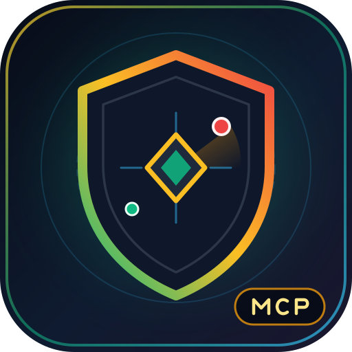

# OFAC Sanctions, AML & Crypto Wallet Screening API

**Category:** Compliance, AML/KYB & Crypto Sanctions Screening  
**Apify Store:** [https://apify.com/desastreger/ofac-sanctions-aml-pep-screener-mcp](https://apify.com/desastreger/ofac-sanctions-aml-pep-screener-mcp)  
**1-Click OAuth MCP (Zero API Key):** `https://mcp.apify.com/?tools=desastreger/ofac-sanctions-aml-pep-screener-mcp`  
**Direct Standby MCP (Bearer Token):** `https://desastreger--ofac-sanctions-aml-pep-screener-mcp.apify.actor/mcp`  
**Official Data Sources:** US Treasury OFAC Sanctions List Service (`SDN.CSV`, `ALT.CSV`, `ADD.CSV`, `CONS_PRIM.CSV`)

> [!IMPORTANT]
> **Early-Adopter Launch Pricing:** **$0.80 / 1k screens** (`$0.0008`/record) — promotional launch pricing for early Store adopters & MCP integrations. Zero external sanctions API keys or proxies required.

## Overview

Screen individuals, companies, vessels, aircraft, aliases, and cryptocurrency wallet addresses in real time against the **official US Treasury OFAC Sanctions List Service (SLS)** (`17 U.S.C. § 105` public domain). Combines `SDN.CSV`, `ALT.CSV` (`aka` / `f.k.a.` / `n.k.a.`), `ADD.CSV`, and `CONS_PRIM.CSV` (Consolidated Non-SDN) into a cached 6-hour in-memory index for **<15 ms deterministic Standby MCP screening** with `0–100` match scoring (`EXACT_SANCTIONS_HIT`, `STRONG_ALIAS_MATCH`, `POTENTIAL_FUZZY_MATCH`, `CLEAR_NO_HIT`).

- **Zero External API Keys:** Runs 100% deterministically against official US Treasury OFAC exports.
- **Dual Mode:** Call live over MCP (`Streamable HTTP`) from Claude, Cursor, Windsurf, VS Code, or Google Antigravity, OR run batch jobs / webhook pipelines via [Apify Store](https://apify.com/desastreger/ofac-sanctions-aml-pep-screener-mcp) and [`templates/n8n/ofac-aml-counterparty-screening-webhook.json`](../../templates/n8n/ofac-aml-counterparty-screening-webhook.json).

---

## MCP Tool Schemas

### `screen_entities_ofac_aml`

Screen 1 to 100 individual, company, vessel, or aircraft names against the live US Treasury OFAC SDN and Consolidated Non-SDN lists plus `ALT.CSV` aliases. Returns deterministic `0-100` `matchScore`, `matchDecision`, programs, addresses, crypto wallets, and parsed IDs (Passport, Tax ID, LEI, IMO).

| Parameter | Type | Description |
| :--- | :--- | :--- |
| `query` | `string` | Single entity, person, vessel, or aircraft name to screen (e.g., `"AEROCARIBBEAN AIRLINES"`). |
| `queries` | `array` | Batch array of up to 100 entity, person, vessel, or aircraft names to screen. |
| `entityType` | `string` | Optional OFAC entity type filter (`"all"`, `"individual"`, `"entity"`, `"vessel"`, `"aircraft"`). Default: `"all"`. |
| `minMatchScore` | `integer` | Minimum deterministic 0-100 similarity score required for a hit (50-100). Default: 70. |
| `includeClearResults` | `boolean` | Emit explicit `CLEAR_NO_HIT` records when a screened name has no match above `minMatchScore`. Default: true. |
| `maxMatchesPerQuery` | `integer` | Maximum candidate matches returned per screened name (1-10). Default: 3. |
| `maxResults` | `integer` | Maximum total dossiers to return across the batch (1-100). Default: 25. |

### `screen_crypto_wallet_sanctions`

Screen 1 to 100 cryptocurrency wallet addresses (`BTC`/`XBT`, `ETH`, `USDT`, `USDC`, `TRX`, `XMR`, `LTC`, `SOL`) against OFAC-sanctioned digital currency addresses parsed from SDN `Remarks`, or list sanctioned OFAC wallet holders filtered by blockchain currency or OFAC program.

| Parameter | Type | Description |
| :--- | :--- | :--- |
| `address` | `string` | Single cryptocurrency wallet address to screen against OFAC SDN Digital Currency Addresses. |
| `cryptoAddresses` | `array` | Batch array of up to 100 cryptocurrency wallet addresses to screen. |
| `currency` | `string` | Optional blockchain currency filter (e.g., `"XBT"`, `"BTC"`, `"ETH"`, `"USDT"`, `"TRX"`, `"XMR"`) to filter hits or list sanctioned wallets. |
| `programFilter` | `string` | Optional OFAC sanctions program filter (e.g., `"CYBER2"`, `"SDGT"`, `"DPRK4"`, `"RUSSIA-EO14024"`). |
| `includeClearResults` | `boolean` | Emit `CLEAR_NO_HIT` records for unflagged wallet addresses. Default: true. |
| `maxResults` | `integer` | Maximum dossiers to return (1-100). Default: 25. |

### `search_ofac_sanctions_by_program`

Browse and filter live US Treasury OFAC SDN and Consolidated Non-SDN entries by sanctions program (`SDGT`, `CYBER2`, `RUSSIA-EO14024`, `DPRK`, `IRAN`, `CMIC`, `CUBA`), country, entity type (`individual`, `entity`, `vessel`, `aircraft`), or keyword.

| Parameter | Type | Description |
| :--- | :--- | :--- |
| `programFilter` | `string` | OFAC program code filter (e.g., `"SDGT"`, `"CYBER2"`, `"RUSSIA-EO14024"`, `"DPRK"`, `"IRAN"`, `"CMIC"`, `"CUBA"`). |
| `countryFilter` | `string` | Case-insensitive country filter across OFAC `ADD.CSV` addresses (e.g., `"Iran"`, `"Russia"`, `"Cuba"`). |
| `entityType` | `string` | Entity type filter (`"all"`, `"individual"`, `"entity"`, `"vessel"`, `"aircraft"`). Default: `"all"`. |
| `listSource` | `string` | Restrict to SDN or Consolidated Non-SDN list (`"ALL"`, `"OFAC_SDN"`, `"OFAC_CONSOLIDATED_NON_SDN"`). Default: `"ALL"`. |
| `keyword` | `string` | Optional keyword across primary name, aliases, remarks, programs, or countries. |
| `maxResults` | `integer` | Maximum sanctioned dossiers to return (1-100). Default: 25. |

---

## Sample Output JSON

```json
{
  "queryInput": "AEROCARIBBEAN AIRLINES",
  "matchDecision": "EXACT_SANCTIONS_HIT",
  "matchScore": 100,
  "ofacEntNum": "36",
  "listSource": "OFAC_SDN",
  "primaryName": "AEROCARIBBEAN AIRLINES",
  "matchedAlias": null,
  "entityType": "entity",
  "programs": ["CUBA"],
  "countries": ["Cuba"],
  "addresses": [
    {
      "address": null,
      "cityStatePostal": "Havana",
      "country": "Cuba"
    }
  ],
  "aliases": ["AERO-CARIBBEAN"],
  "cryptoWallets": [],
  "idNumbers": []
}
```

---

## Quickstart

### Option 1: 1-Click Browser OAuth (Zero API Key Setup)

Connect directly via Apify's managed OAuth MCP gateway — your AI client opens a browser login once and requires **no manual `APIFY_TOKEN`** in config files:

```bash
# Claude Code CLI (1-Click OAuth)
claude mcp add --transport http ofac-sanctions-aml-pep-screener-mcp "https://mcp.apify.com/?tools=desastreger/ofac-sanctions-aml-pep-screener-mcp"
```

**Claude Desktop / Cursor / Windsurf / Google Antigravity (`mcp_config.json`):**
```json
{
  "mcpServers": {
    "ofac-sanctions-aml-pep-screener-mcp": {
      "url": "https://mcp.apify.com/?tools=desastreger/ofac-sanctions-aml-pep-screener-mcp"
    }
  }
}
```

**VS Code Copilot (`.vscode/mcp.json`):**
```json
{
  "servers": {
    "ofac-sanctions-aml-pep-screener-mcp": {
      "type": "http",
      "url": "https://mcp.apify.com/?tools=desastreger/ofac-sanctions-aml-pep-screener-mcp"
    }
  }
}
```

### Option 2: Direct Standby Streamable HTTP (`Bearer $APIFY_TOKEN`)

For headless automation, CI/CD, or direct token-authenticated clients:

```json
{
  "mcpServers": {
    "ofac-sanctions-aml-pep-screener-mcp": {
      "url": "https://desastreger--ofac-sanctions-aml-pep-screener-mcp.apify.actor/mcp",
      "headers": {
        "Authorization": "Bearer <YOUR_APIFY_TOKEN>"
      }
    }
  }
}
```

### cURL (`tools/call`)

```bash
curl -sS -X POST "https://desastreger--ofac-sanctions-aml-pep-screener-mcp.apify.actor/mcp" \
  -H "Authorization: Bearer <YOUR_APIFY_TOKEN>" \
  -H "Content-Type: application/json" \
  -H "Accept: application/json, text/event-stream" \
  -d '{"jsonrpc":"2.0","id":1,"method":"tools/call","params":{"name":"screen_entities_ofac_aml","arguments":{"queries":["AEROCARIBBEAN AIRLINES","ACME WIDGETS LLC"],"minMatchScore":70,"includeClearResults":true}}}'
```

### JavaScript (`apify-client`)

```js
import { ApifyClient } from 'apify-client';

const client = new ApifyClient({ token: process.env.APIFY_TOKEN });
const run = await client.actor('desastreger/ofac-sanctions-aml-pep-screener-mcp').call({
  queries: ['AEROCARIBBEAN AIRLINES'],
  cryptoAddresses: [],
  minMatchScore: 70,
  includeClearResults: true,
  maxResults: 25,
});
const { items } = await client.dataset(run.defaultDatasetId).listItems();
console.log(items);
```

### Python (`apify-client`)

```python
import os
from apify_client import ApifyClient

client = ApifyClient(os.environ["APIFY_TOKEN"])
run = client.actor("desastreger/ofac-sanctions-aml-pep-screener-mcp").call(
    run_input={"queries": ["AEROCARIBBEAN AIRLINES"], "minMatchScore": 70, "includeClearResults": True}
)
print(client.dataset(run["defaultDatasetId"]).list_items().items)
```

---

[← Back to All 16 Open Data MCP Servers](../../README.md) · [Open on Apify Store →](https://apify.com/desastreger/ofac-sanctions-aml-pep-screener-mcp)
