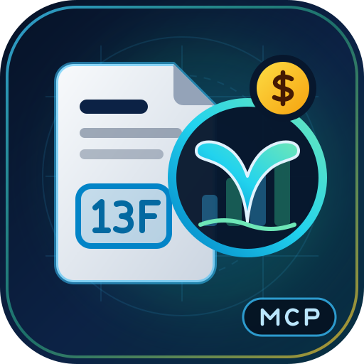

# SEC Form 13F Hedge Fund & Institutional Whale Holdings Scraper

**Category:** Hedge Funds, Institutional Ownership & Financial Signals  
**Apify Store:** [https://apify.com/desastreger/sec-13f-institutional-whale-holdings](https://apify.com/desastreger/sec-13f-institutional-whale-holdings)  
**1-Click OAuth MCP (Zero API Key):** `https://mcp.apify.com/?tools=desastreger/sec-13f-institutional-whale-holdings`  
**Direct Standby MCP (Bearer Token):** `https://desastreger--sec-13f-institutional-whale-holdings.apify.actor/mcp`  
**Official Data Sources:** SEC EDGAR Form 13F-HR XML (`primary_doc.xml` + `<informationTable>`), SEC Submissions API, SEC EFTS API, SEC `company_tickers.json`

> [!IMPORTANT]
> **Early-Adopter Launch Pricing:** **$0.80 / 1k holdings** (`$0.0008`/holding) — promotional launch pricing for early Store adopters & MCP integrations. Zero external SEC API keys or proxies required.

## Overview

Extract real-time US institutional investment manager, hedge fund, and family office equity & option holdings directly from official **SEC EDGAR Form 13F-HR** XML filings (`17 U.S.C. § 105`). Track Berkshire Hathaway (`0001067983`), Bridgewater, Citadel, and thousands of `$100M+` institutional managers—with exact USD market values (`X0202` & legacy `X0201`), share/principal counts, **Put/Call** option flags, FIGI/CUSIP identifiers, `portfolioWeightPct`, investment discretion (`SOLE` / `DFND` / `OTR`), voting authority, and manager signer contact details.

- **Zero External API Keys:** Runs 100% deterministically against public-domain SEC EDGAR APIs (`<= 5 req/sec` Fair Access compliant).
- **Dual Mode:** Call live over MCP (`Streamable HTTP`) from Claude, Cursor, Windsurf, VS Code, or Google Antigravity, OR run batch jobs on [Apify Store](https://apify.com/desastreger/sec-13f-institutional-whale-holdings).

---

## MCP Tool Schemas

### `search_13f_whale_holdings`

Search real-time US institutional investor & hedge fund holdings from official SEC EDGAR Form 13F-HR XML filings (`primary_doc.xml` + `informationTable`). Filter by manager CIKs, issuer/ticker/CUSIP/fund keyword, Put/Call options only, minimum USD position value, and top N holdings per manager.

| Parameter | Type | Description |
| :--- | :--- | :--- |
| `managerCiks` | `array` | Optional SEC manager CIKs (e.g., `["0001067983"]` for Berkshire Hathaway). |
| `query` | `string` | Optional issuer name, ticker (e.g., `"NVDA"`), CUSIP, or fund name keyword. |
| `daysBack` | `integer` | Lookback window in days (1-365). Automatically expands to 90 days if empty. Default: 30. |
| `minPositionValueUsd` | `number` | Minimum USD position value. Default: 0. |
| `optionsOnly` | `boolean` | When true, returns only Put/Call options positions. Default: false. |
| `topHoldingsPerManager` | `integer` | Top N largest positions per filing sorted by USD value desc (1-100). Default: 5. |
| `maxResults` | `integer` | Maximum total holding rows to return (1-50 in MCP mode). Default: 10. |

### `get_fund_13f_portfolio`

Pull the latest SEC Form 13F-HR portfolio summary and largest holdings for a specific institutional manager or hedge fund by CIK (e.g., `"0001067983"`) or manager name (e.g., `"Berkshire Hathaway"`). Returns total reported AUM, `tableEntryTotal`, signer contact, and top positions with portfolio weights.

| Parameter | Type | Description |
| :--- | :--- | :--- |
| `managerCikOrName` | `string` **(required)** | Institutional manager 10-digit SEC CIK (e.g., `"0001067983"`) or fund name (e.g., `"Berkshire Hathaway"`). |
| `topHoldings` | `integer` | Number of largest positions to return (1-50). Default: 15. |
| `optionsOnly` | `boolean` | Return only Put/Call options holdings. Default: false. |
| `minPositionValueUsd` | `number` | Minimum USD position size. Default: 0. |
| `includeAmendments` | `boolean` | Include Form 13F-HR/A amendments. Default: true. |

### `find_institutional_holders_by_issuer`

Find institutional whale managers holding a specific stock issuer, ticker, or 9-character CUSIP across recent SEC Form 13F-HR filings (e.g., `"NVIDIA"`, `"NVDA"`, or `"67066G104"`), ranked by USD position value descending.

| Parameter | Type | Description |
| :--- | :--- | :--- |
| `issuerOrCusip` | `string` **(required)** | Issuer name (e.g., `"NVIDIA"`), stock ticker (e.g., `"NVDA"`), or 9-character CUSIP (e.g., `"67066G104"`). |
| `daysBack` | `integer` | Lookback window in days (1-365). Default: 30 (auto-expands to 90 if needed). |
| `optionsOnly` | `boolean` | Only include Put/Call options positions on this issuer. Default: false. |
| `minPositionValueUsd` | `number` | Minimum USD position value. Default: 0. |
| `maxResults` | `integer` | Maximum institutional holders to return (1-50). Default: 15. |

---

## Sample Output JSON

```json
{
  "accessionNumber": "0001193125-26-463399",
  "filingType": "13F-HR",
  "isAmendment": false,
  "filingDate": "2026-11-16",
  "periodOfReport": "2026-09-30",
  "managerCik": "0001067983",
  "managerName": "Berkshire Hathaway Inc",
  "managerCity": "Omaha",
  "managerState": "NE",
  "signerName": "Marc D. Hamburg",
  "signerTitle": "Senior Vice President",
  "signerPhone": "402-346-1400",
  "tableEntryTotal": 89,
  "tableValueTotalUsd": 304196581325,
  "nameOfIssuer": "APPLE INC",
  "titleOfClass": "COM",
  "cusip": "037833100",
  "valueUsd": 69850000000,
  "sharesOrPrincipalAmount": 300000000,
  "sharesOrPrincipalType": "SH",
  "putCall": null,
  "investmentDiscretion": "DFND",
  "portfolioWeightPct": 22.96,
  "edgarFilingUrl": "https://www.sec.gov/Archives/edgar/data/1067983/000119312526463399/0001193125-26-463399-index.htm"
}
```

---

## Quickstart

### Option 1: 1-Click Browser OAuth (Zero API Key Setup)

Connect directly via Apify's managed OAuth MCP gateway — your AI client opens a browser login once and requires **no manual `APIFY_TOKEN`** in config files:

```bash
# Claude Code CLI (1-Click OAuth)
claude mcp add --transport http sec-13f-institutional-whale-holdings "https://mcp.apify.com/?tools=desastreger/sec-13f-institutional-whale-holdings"
```

**Claude Desktop / Cursor / Windsurf / Google Antigravity (`mcp_config.json`):**
```json
{
  "mcpServers": {
    "sec-13f-institutional-whale-holdings": {
      "url": "https://mcp.apify.com/?tools=desastreger/sec-13f-institutional-whale-holdings"
    }
  }
}
```

**VS Code Copilot (`.vscode/mcp.json`):**
```json
{
  "servers": {
    "sec-13f-institutional-whale-holdings": {
      "type": "http",
      "url": "https://mcp.apify.com/?tools=desastreger/sec-13f-institutional-whale-holdings"
    }
  }
}
```

### Option 2: Direct Standby Streamable HTTP (`Bearer $APIFY_TOKEN`)

For headless automation, CI/CD, or direct token-authenticated clients:

```json
{
  "mcpServers": {
    "sec-13f-institutional-whale-holdings": {
      "url": "https://desastreger--sec-13f-institutional-whale-holdings.apify.actor/mcp",
      "headers": {
        "Authorization": "Bearer <YOUR_APIFY_TOKEN>"
      }
    }
  }
}
```

### cURL (`tools/call`)

```bash
curl -sS -X POST "https://desastreger--sec-13f-institutional-whale-holdings.apify.actor/mcp" \
  -H "Authorization: Bearer <YOUR_APIFY_TOKEN>" \
  -H "Content-Type: application/json" \
  -H "Accept: application/json, text/event-stream" \
  -d '{"jsonrpc":"2.0","id":1,"method":"tools/call","params":{"name":"get_fund_13f_portfolio","arguments":{"managerCikOrName":"0001067983","topHoldings":10}}}'
```

### JavaScript (`apify-client`)

```js
import { ApifyClient } from 'apify-client';

const client = new ApifyClient({ token: process.env.APIFY_TOKEN });
const run = await client.actor('desastreger/sec-13f-institutional-whale-holdings').call({
  managerCiks: ['0001067983'],
  daysBack: 30,
  topHoldingsPerManager: 10,
  maxResults: 10,
});
const { items } = await client.dataset(run.defaultDatasetId).listItems();
console.log(items);
```

### Python (`apify-client`)

```python
import os
from apify_client import ApifyClient

client = ApifyClient(os.environ["APIFY_TOKEN"])
run = client.actor("desastreger/sec-13f-institutional-whale-holdings").call(
    run_input={"query": "NVDA", "daysBack": 30, "topHoldingsPerManager": 2, "maxResults": 10}
)
print(client.dataset(run["defaultDatasetId"]).list_items().items)
```

---

[← Back to All 16 Open Data MCP Servers](../../README.md) · [Open on Apify Store →](https://apify.com/desastreger/sec-13f-institutional-whale-holdings)
