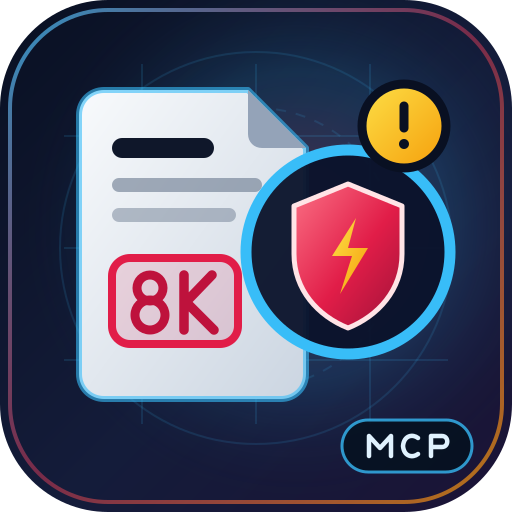

# SEC Form 8-K Material Events, M&A, Cyber & CEO Scraper

**Category:** B2B Trigger Intelligence, Cybersecurity IR & Event-Driven Finance  
**Apify Store:** [https://apify.com/desastreger/sec-8k-material-events-cyber-ma-radar](https://apify.com/desastreger/sec-8k-material-events-cyber-ma-radar)  
**1-Click OAuth MCP (Zero API Key):** `https://mcp.apify.com/?tools=desastreger/sec-8k-material-events-cyber-ma-radar`  
**Direct Standby MCP (Bearer Token):** `https://desastreger--sec-8k-material-events-cyber-ma-radar.apify.actor/mcp`  
**Official Data Sources:** SEC EDGAR Full-Text Search (EFTS `efts.sec.gov`) & SEC Submissions JSON (`data.sec.gov`)

> [!IMPORTANT]
> **Early-Adopter Launch Pricing:** **$0.80 / 1k records** (`$0.0008`/record) — promotional launch pricing for early Store adopters & MCP integrations. Zero external SEC API keys or proxies required.

## Overview

Monitor real-time **SEC EDGAR Form `8-K` and `8-K/A`** material corporate event filings directly from official **SEC EDGAR EFTS and Submissions APIs** (`17 U.S.C. § 105` public domain). Decodes every 8-K item code (`1.01`–`9.01`), classifies high-intent B2B trigger categories (`CYBERSECURITY_BREACH`, `MA_DEFINITIVE_DEAL`, `EXECUTIVE_TURNOVER`, `RESTRUCTURING_LAYOFFS`, `DISTRESS_BANKRUPTCY_DELISTING`, `ACCOUNTING_RESTATEMENT_AUDITOR`), and computes deterministic `0–100` `materialityScore`, `severityTier`, `outreachAngle`, and direct EDGAR filing URLs.

- **Zero External API Keys:** Runs deterministically against official `efts.sec.gov` and `data.sec.gov` endpoints with compliant `User-Agent` rate limiting.
- **Dual Mode:** Call live over MCP (`Streamable HTTP`) from Claude, Cursor, Windsurf, VS Code, or Google Antigravity, OR trigger real-time cyber/M&A webhooks via [Apify Store](https://apify.com/desastreger/sec-8k-material-events-cyber-ma-radar) and [`templates/n8n/sec-8k-cyber-breach-ma-webhook.json`](../../templates/n8n/sec-8k-cyber-breach-ma-webhook.json).

---

## MCP Tool Schemas

### `search_sec_8k_material_events`

Search US public company SEC Form `8-K` & `8-K/A` material event filings via official SEC EDGAR EFTS API. Filter by `eventCategory` (`cybersecurity`, `ma_deals`, `exec_changes`, `layoffs_distress`, `accounting`), explicit 8-K `itemCodes` (e.g., `["1.05", "5.02"]`), keyword `query`, or stock tickers/CIKs.

| Parameter | Type | Description |
| :--- | :--- | :--- |
| `eventCategory` | `string` | High-intent B2B trigger category filter (`"all"`, `"cybersecurity"`, `"ma_deals"`, `"exec_changes"`, `"layoffs_distress"`, `"accounting"`). Default: `"all"`. |
| `itemCodes` | `array` | Optional explicit Form 8-K item codes (e.g., `["1.05", "2.01", "5.02"]`). Overrides `eventCategory` if provided. |
| `query` | `string` | Optional full-text search phrase across Form 8-K filings (e.g., `"ransomware"`, `"chief financial officer"`). |
| `ciksOrTickers` | `array` | Optional stock tickers (e.g., `["AAPL", "MSFT"]`) or 10-digit SEC CIKs. |
| `daysBack` | `integer` | Lookback window in days (`1-3650`); automatically widens to `90` days if 0 hits. Default: `7`. |
| `excludeRegFdOnly` | `boolean` | Skip routine filings that contain only Item 7.01 (Reg FD), 8.01 (Other), or 9.01 (Exhibits). Default: `false`. |
| `enrichSubmissions` | `boolean` | Enrich each hit with SIC description, stock exchange, and full ticker list from `data.sec.gov/submissions`. Default: `false`. |
| `maxResults` | `integer` | Maximum Form 8-K events to return (`1-50` in MCP mode). Default: `10`. |

### `scan_cyber_and_distress_8k_alerts`

Scan high-severity SEC Form `8-K` & `8-K/A` trigger alerts across Item 1.05 (material cybersecurity incidents), Item 1.03 (bankruptcy), Item 2.04/2.05/2.06 (debt acceleration, layoffs, impairments), Item 3.01 (exchange delisting), Item 4.01/4.02 (auditor changes & restatements), and Item 5.02 (CEO/CFO turnover), ranked by highest `materialityScore`.

| Parameter | Type | Description |
| :--- | :--- | :--- |
| `focus` | `string` | Alert focus bucket (`"all_alerts"`, `"cyber_only"`, `"distress_and_layoffs"`, `"restatements_and_auditors"`, `"exec_turnover"`). Default: `"all_alerts"`. |
| `query` | `string` | Optional keyword filter within alert filings. |
| `minMaterialityScore` | `integer` | Minimum `materialityScore` threshold (`0-100`). Default: `70`. |
| `daysBack` | `integer` | Lookback window in days (`1-3650`). Default: `30`. |
| `enrichSubmissions` | `boolean` | Enrich matched issuers via `data.sec.gov/submissions`. Default: `false`. |
| `maxResults` | `integer` | Maximum high-severity alerts to return (`1-50`). Default: `10`. |

### `get_company_8k_event_timeline`

Retrieve a complete Form `8-K` / `8-K/A` material event timeline for a specific US public company by stock ticker (e.g., `"AAPL"`, `"CRWD"`) or 10-digit SEC CIK via official `data.sec.gov/submissions`, including SIC classification, exchanges, decoded item codes, materiality scores, and direct filing URLs.

| Parameter | Type | Description |
| :--- | :--- | :--- |
| `tickerOrCik` | `string` | **Required.** Stock ticker (e.g., `"AAPL"`, `"MSFT"`) or SEC CIK (e.g., `"0000320193"`). |
| `eventCategory` | `string` | Optional trigger category filter (`"all"`, `"cybersecurity"`, `"ma_deals"`, `"exec_changes"`, `"layoffs_distress"`, `"accounting"`). Default: `"all"`. |
| `itemCodes` | `array` | Optional explicit 8-K item codes filter. |
| `daysBack` | `integer` | Lookback window in days (`1-3650`). Default: `365`. |
| `excludeRegFdOnly` | `boolean` | Exclude routine Reg FD / Exhibits-only filings. Default: `false`. |
| `maxResults` | `integer` | Maximum 8-K filings to return (`1-50`). Default: `15`. |

---

## Sample Output JSON

```json
{
  "accessionNumber": "0001784254-26-000056",
  "formType": "8-K",
  "isAmendment": false,
  "filingDate": "2026-11-23",
  "cik": "0001784254",
  "companyName": "Mediaco Holding Inc.",
  "tickers": ["MDIA"],
  "primaryTicker": "MDIA",
  "sic": "4832",
  "bizLocation": "New York, NY",
  "itemCodes": ["5.02"],
  "itemLabels": [
    "Item 5.02: Departure of Directors or Certain Officers; Election/Appointment of Officers"
  ],
  "eventCategories": ["EXECUTIVE_TURNOVER"],
  "primaryCategory": "EXECUTIVE_TURNOVER",
  "isRegFdOnly": false,
  "materialityScore": 72,
  "severityTier": "HIGH",
  "outreachAngle": "Executive search, interim CFO/C-suite advisory, new-leader 100-day vendor reset & board governance consulting",
  "edgarFilingIndexUrl": "https://www.sec.gov/Archives/edgar/data/1784254/000178425426000056/0001784254-26-000056-index.htm",
  "primaryDocumentUrl": "https://www.sec.gov/Archives/edgar/data/1784254/000178425426000056/mdia-20261123.htm"
}
```

---

## Quickstart

### Option 1: 1-Click Browser OAuth (Zero API Key Setup)

Connect directly via Apify's managed OAuth MCP gateway — your AI client opens a browser login once and requires **no manual `APIFY_TOKEN`** in config files:

```bash
# Claude Code CLI (1-Click OAuth)
claude mcp add --transport http sec-8k-material-events-cyber-ma-radar "https://mcp.apify.com/?tools=desastreger/sec-8k-material-events-cyber-ma-radar"
```

**Claude Desktop / Cursor / Windsurf / Google Antigravity (`mcp_config.json`):**
```json
{
  "mcpServers": {
    "sec-8k-material-events-cyber-ma-radar": {
      "url": "https://mcp.apify.com/?tools=desastreger/sec-8k-material-events-cyber-ma-radar"
    }
  }
}
```

**VS Code Copilot (`.vscode/mcp.json`):**
```json
{
  "servers": {
    "sec-8k-material-events-cyber-ma-radar": {
      "type": "http",
      "url": "https://mcp.apify.com/?tools=desastreger/sec-8k-material-events-cyber-ma-radar"
    }
  }
}
```

### Option 2: Direct Standby Streamable HTTP (`Bearer $APIFY_TOKEN`)

For headless automation, CI/CD, or direct token-authenticated clients:

```json
{
  "mcpServers": {
    "sec-8k-material-events-cyber-ma-radar": {
      "url": "https://desastreger--sec-8k-material-events-cyber-ma-radar.apify.actor/mcp",
      "headers": {
        "Authorization": "Bearer <YOUR_APIFY_TOKEN>"
      }
    }
  }
}
```

### cURL (`tools/call`)

```bash
curl -sS -X POST "https://desastreger--sec-8k-material-events-cyber-ma-radar.apify.actor/mcp" \
  -H "Authorization: Bearer <YOUR_APIFY_TOKEN>" \
  -H "Content-Type: application/json" \
  -H "Accept: application/json, text/event-stream" \
  -d '{"jsonrpc":"2.0","id":1,"method":"tools/call","params":{"name":"scan_cyber_and_distress_8k_alerts","arguments":{"focus":"cyber_only","daysBack":30,"maxResults":10}}}'
```

### JavaScript (`apify-client`)

```js
import { ApifyClient } from 'apify-client';

const client = new ApifyClient({ token: process.env.APIFY_TOKEN });
const run = await client.actor('desastreger/sec-8k-material-events-cyber-ma-radar').call({
  eventCategory: 'cybersecurity',
  daysBack: 30,
  excludeRegFdOnly: true,
  maxResults: 10,
});
const { items } = await client.dataset(run.defaultDatasetId).listItems();
console.log(items);
```

### Python (`apify-client`)

```python
import os
from apify_client import ApifyClient

client = ApifyClient(os.environ["APIFY_TOKEN"])
run = client.actor("desastreger/sec-8k-material-events-cyber-ma-radar").call(
    run_input={
        "eventCategory": "ma_deals",
        "daysBack": 14,
        "excludeRegFdOnly": True,
        "maxResults": 10,
    }
)
print(client.dataset(run["defaultDatasetId"]).list_items().items)
```

---

[← Back to All 20 Open Data MCP Servers](../../README.md) · [Open on Apify Store →](https://apify.com/desastreger/sec-8k-material-events-cyber-ma-radar)
