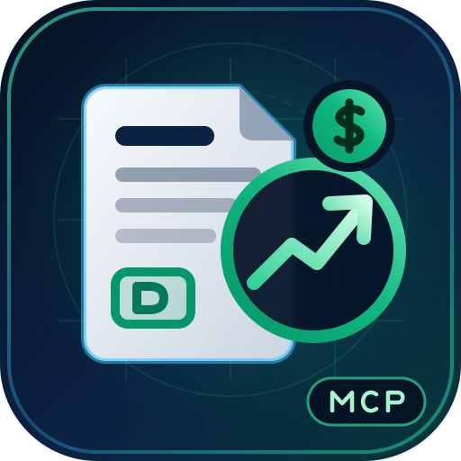

# SEC Form D Scraper — Startup Funding & EIN ($1/1k)

**Category:** Venture Funding & Executive Contacts  
**Apify Store:** [https://apify.com/desastreger/sec-form-d-funding-leads](https://apify.com/desastreger/sec-form-d-funding-leads)  
**1-Click OAuth MCP (Zero API Key):** `https://mcp.apify.com/?tools=desastreger/sec-form-d-funding-leads`  
**Direct Standby MCP (Bearer Token):** `https://desastreger--sec-form-d-funding-leads.apify.actor/mcp`  
**Official Data Sources:** SEC EDGAR Form D XML, SEC Submissions API, USASpending.gov

> [!IMPORTANT]
> **Early-Adopter Launch Pricing:** **$1.00 / 1k records** (`$0.001`/record) — promotional launch pricing while early adopters onboard. Scheduled to step up to our standard **$2.50 / 1k records** (`$0.0025`/record) rate after the launch window, still **75%–95% cheaper** than comparable Store scrapers.
> Optional USASpending grant enrichment: `$0.30 / 1k` (`$0.0003`/lead).

## Overview

Real-time US startup venture & Reg D private placement rounds directly from SEC EDGAR Form D XML filings. Filters out pooled hedge/PE funds automatically and extracts CEO/founder names, phones, HQ addresses, EINs, and federal grant history.

- **Zero External API Keys:** Runs 100% deterministically against public-domain government APIs and RFC protocols.
- **Dual Mode:** Call live over MCP (`Streamable HTTP`) from Claude, Cursor, Windsurf, VS Code, or Google Antigravity, OR run batch jobs on [Apify Store](https://apify.com/desastreger/sec-form-d-funding-leads).

---

## MCP Tool Schemas

### `search_startup_funding_leads`

Search real-time US startup venture & private placement funding rounds from official SEC EDGAR Form D filings. Returns decision-maker names/titles, phone, HQ address, exact amount raised, EIN, and optional federal grant history.

| Parameter | Type | Description |
| :--- | :--- | :--- |
| `daysBack` | `integer` | Lookback window in days (1-365). Default: 7. |
| `startDate` | `string` | Optional explicit YYYY-MM-DD start date. |
| `endDate` | `string` | Optional explicit YYYY-MM-DD end date. |
| `maxResults` | `integer` | Maximum leads to return (1-50 in MCP mode). Default: 10. |
| `operatingCompaniesOnly` | `boolean` | Exclude pooled hedge/PE/VC funds and SPVs so only operating startups are returned. Default: true. |
| `minAmountSold` | `number` | Minimum USD capital already closed in the round (e.g., 250000). |
| `states` | `array` | Filter by 2-letter US state codes (e.g., ["CA", "NY", "TX"]). |
| `industries` | `array` | Filter by industry keywords (e.g., ["Technology", "Biotechnology", "Health Care"]). |
| `searchQuery` | `string` | Optional full-text keyword or company name filter. |
| `enrichWithFederalAwards` | `boolean` | Cross-check USASpending.gov for SBIR/STTR grants & federal contracts. Default: false. |

### `get_company_funding_dossier`

Look up a specific US private company by name or CIK across SEC EDGAR Form D filings, SEC entity metadata (EIN, SIC, prior rounds), and USASpending.gov federal contracts/grants.

| Parameter | Type | Description |
| :--- | :--- | :--- |
| `companyQuery` | `string` **(required)** | Company legal name or 10-digit SEC CIK. |
| `daysBack` | `integer` | Lookback window in days (default: 365). |

### `summarize_funding_market`

Aggregate recent US private placement volume, median/total capital raised, top states, and top industries from recent SEC Form D operating startup filings.

| Parameter | Type | Description |
| :--- | :--- | :--- |
| `daysBack` | `integer` | Lookback window in days (default: 7). |
| `sampleSize` | `integer` | Number of operating startup filings to analyze (5-50, default: 20). |

---

## Sample Output JSON

```json
{
  "accessionNumber": "0002163331-26-000001",
  "cik": "0002163331",
  "companyName": "INNOVATIVE POWDERS INC",
  "entityType": "Corporation",
  "industryGroup": "Manufacturing",
  "filingDate": "2026-11-10",
  "totalOfferingAmount": 7500000,
  "totalAmountSold": 250000,
  "primaryContactName": "Daniel Thomas Turner",
  "primaryContactTitle": "Chief Executive Officer and Director",
  "phone": "(717) 271-2984",
  "leadScore": 86
}
```

---

## Quickstart

### Option 1: 1-Click Browser OAuth (Zero API Key Setup)

Connect directly via Apify's managed OAuth MCP gateway — your AI client opens a browser login once and requires **no manual `APIFY_TOKEN`** in config files:

```bash
# Claude Code CLI (1-Click OAuth)
claude mcp add --transport http sec-form-d-funding-leads "https://mcp.apify.com/?tools=desastreger/sec-form-d-funding-leads"
```

**Claude Desktop / Cursor / Windsurf / Google Antigravity (`mcp_config.json`):**
```json
{
  "mcpServers": {
    "sec-form-d-funding-leads": {
      "url": "https://mcp.apify.com/?tools=desastreger/sec-form-d-funding-leads"
    }
  }
}
```

**VS Code Copilot (`.vscode/mcp.json`):**
```json
{
  "servers": {
    "sec-form-d-funding-leads": {
      "type": "http",
      "url": "https://mcp.apify.com/?tools=desastreger/sec-form-d-funding-leads"
    }
  }
}
```

### Option 2: Direct Standby Streamable HTTP (`Bearer $APIFY_TOKEN`)

For headless automation, CI/CD, or direct token-authenticated clients:

```json
{
  "mcpServers": {
    "sec-form-d-funding-leads": {
      "url": "https://desastreger--sec-form-d-funding-leads.apify.actor/mcp",
      "headers": {
        "Authorization": "Bearer <YOUR_APIFY_TOKEN>"
      }
    }
  }
}
```

### cURL (`tools/call`)

```bash
curl -sS -X POST "https://desastreger--sec-form-d-funding-leads.apify.actor/mcp" \
  -H "Authorization: Bearer <YOUR_APIFY_TOKEN>" \
  -H "Content-Type: application/json" \
  -H "Accept: application/json, text/event-stream" \
  -d '{"jsonrpc":"2.0","id":1,"method":"tools/call","params":{"name":"search_startup_funding_leads","arguments":{"daysBack":7,"maxResults":5,"operatingCompaniesOnly":true,"includeSecEntityMetadata":true}}}'
```

### JavaScript (`apify-client`)

```js
import { ApifyClient } from 'apify-client';

const client = new ApifyClient({ token: process.env.APIFY_TOKEN });
const run = await client.actor('desastreger/sec-form-d-funding-leads').call({
  "daysBack": 7,
  "maxResults": 5,
  "operatingCompaniesOnly": true,
  "includeSecEntityMetadata": true
});
const { items } = await client.dataset(run.defaultDatasetId).listItems();
console.log(items);
```

### Python (`apify-client`)

```python
import os
from apify_client import ApifyClient

client = ApifyClient(os.environ["APIFY_TOKEN"])
run = client.actor("desastreger/sec-form-d-funding-leads").call(run_input={"daysBack":7,"maxResults":5,"operatingCompaniesOnly":true,"includeSecEntityMetadata":true})
print(client.dataset(run["defaultDatasetId"]).list_items().items)
```

---

[← Back to All 10 Open Data MCP Servers](../../README.md) · [Open on Apify Store →](https://apify.com/desastreger/sec-form-d-funding-leads)
