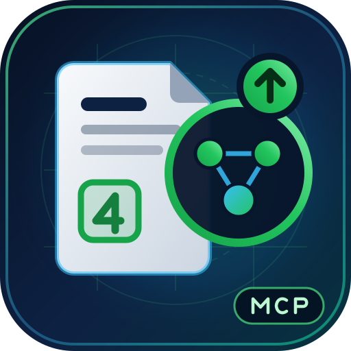

# SEC Form 4 Insider Trading & Cluster Buy Signals Scraper

**Category:** Equity Research & Insider Signals  
**Apify Store:** [https://apify.com/desastreger/sec-form4-insider-cluster-signals](https://apify.com/desastreger/sec-form4-insider-cluster-signals)  
**1-Click OAuth MCP (Zero API Key):** `https://mcp.apify.com/?tools=desastreger/sec-form4-insider-cluster-signals`  
**Direct Standby MCP (Bearer Token):** `https://desastreger--sec-form4-insider-cluster-signals.apify.actor/mcp`  
**Official Data Sources:** SEC EDGAR Form 4 XML, SEC Submissions API, SEC EFTS API

> [!IMPORTANT]
> **Early-Adopter Launch Pricing:** **$0.80 / 1k signals** (`$0.0008`/signal) — promotional launch pricing while early adopters onboard. Zero external financial API keys or proxies required.

## Overview

Extract real-time US corporate insider purchases, sales, and multi-insider cluster buy signals directly from official **SEC EDGAR Form 4** (`<ownershipDocument>`) XML filings (`17 U.S.C. § 105`). Filter market-wide Form 4 filings or target specific stock tickers (`NVDA`, `AAPL`, `MSFT`) and CIKs, isolate discretionary open-market purchases (`transactionCode: "P"`), exclude scheduled **Rule 10b5-1** plans (`aff10b5One`), compute multi-insider `clusterBuyCount`, and rank high-conviction C-suite buys with a deterministic `0–100` `signalScore`.

- **Zero External API Keys:** Runs 100% deterministically against public-domain SEC EDGAR APIs (`<= 5 req/sec`).
- **Dual Mode:** Call live over MCP (`Streamable HTTP`) from Claude, Cursor, Windsurf, VS Code, or Google Antigravity, OR run batch jobs on [Apify Store](https://apify.com/desastreger/sec-form4-insider-cluster-signals).

---

## MCP Tool Schemas

### `search_form4_insider_trades`

Search real-time US corporate insider buys and sales from official SEC EDGAR Form 4 XML filings. Filter by stock tickers, CIKs, date window, open-market purchases only (`P`), Rule 10b5-1 exclusion, or minimum USD transaction value.

| Parameter | Type | Description |
| :--- | :--- | :--- |
| `tickers` | `array` | Optional US stock tickers (e.g., `["NVDA", "AAPL"]`). Omit for market-wide Form 4 scan. |
| `ciks` | `array` | Optional SEC CIK numbers (e.g., `["0001045810"]`). |
| `daysBack` | `integer` | Lookback window in days (1-365). Default: 7. |
| `startDate` | `string` | Optional explicit `YYYY-MM-DD` start date. |
| `endDate` | `string` | Optional explicit `YYYY-MM-DD` end date. |
| `openMarketPurchasesOnly` | `boolean` | Only return filings with open-market purchases (`transactionCode = P`). Default: false. |
| `exclude10b51Plans` | `boolean` | Exclude pre-scheduled Rule 10b5-1 plan trades (`aff10b5One = true`). Default: false. |
| `minTransactionValueUsd` | `number` | Minimum transaction dollar value in USD. Default: 0. |
| `searchQuery` | `string` | Optional company, ticker, or insider name keyword. |
| `maxResults` | `integer` | Maximum signals to return (1-50 in MCP mode). Default: 10. |

### `get_company_insider_dossier`

Pull a complete insider trading dossier for a specific US public company by stock ticker or 10-digit SEC CIK, summarizing net insider buying vs selling, Rule 10b5-1 plan ratio, cluster buy count, and recent Form 4 / 4/A filings.

| Parameter | Type | Description |
| :--- | :--- | :--- |
| `tickerOrCik` | `string` **(required)** | Stock ticker symbol (e.g., `"NVDA"`) or 10-digit SEC CIK (e.g., `"0001045810"`). |
| `daysBack` | `integer` | Lookback window in days (1-365). Default: 90. |
| `maxResults` | `integer` | Maximum recent Form 4 filings to inspect (1-50). Default: 15. |
| `includeAmendments` | `boolean` | Include Form 4/A amended filings. Default: true. |

### `detect_insider_cluster_buys`

Scan recent SEC Form 4 filings for multi-insider open-market cluster buys (2+ distinct insiders purchasing shares of the same company with code `P`), prioritizing discretionary C-suite buys outside Rule 10b5-1 plans.

| Parameter | Type | Description |
| :--- | :--- | :--- |
| `tickers` | `array` | Optional list of tickers to check for cluster buys. Omit for market-wide scan. |
| `daysBack` | `integer` | Lookback window in days (1-90). Default: 14. |
| `minClusterSize` | `integer` | Minimum distinct insiders buying the same ticker. Default: 2. |
| `exclude10b51Plans` | `boolean` | Exclude Rule 10b5-1 scheduled purchases. Default: true. |
| `minTransactionValueUsd` | `number` | Minimum USD purchase per filing. Default: 10000. |
| `scanLimit` | `integer` | Number of open-market purchase filings to scan and group (5-100). Default: 40. |

---

## Sample Output JSON

```json
{
  "accessionNumber": "0002122129-26-000002",
  "filingType": "4",
  "filingDate": "2026-11-24",
  "cik": "0001049659",
  "issuerName": "NATIONAL STEEL CO",
  "ticker": "SID",
  "rptOwnerName": "Daher Filho Tufi",
  "officerTitle": "Executive Officer",
  "aff10b5One": false,
  "primaryTransactionCode": "P",
  "totalSharesPurchased": 40000,
  "totalPurchaseValueUsd": 26486,
  "clusterBuyCount": 1,
  "signalScore": 74,
  "signalTier": "MEDIUM"
}
```

---

## Quickstart

### Option 1: 1-Click Browser OAuth (Zero API Key Setup)

Connect directly via Apify's managed OAuth MCP gateway — your AI client opens a browser login once and requires **no manual `APIFY_TOKEN`** in config files:

```bash
# Claude Code CLI (1-Click OAuth)
claude mcp add --transport http sec-form4-insider-cluster-signals "https://mcp.apify.com/?tools=desastreger/sec-form4-insider-cluster-signals"
```

**Claude Desktop / Cursor / Windsurf / Google Antigravity (`mcp_config.json`):**
```json
{
  "mcpServers": {
    "sec-form4-insider-cluster-signals": {
      "url": "https://mcp.apify.com/?tools=desastreger/sec-form4-insider-cluster-signals"
    }
  }
}
```

**VS Code Copilot (`.vscode/mcp.json`):**
```json
{
  "servers": {
    "sec-form4-insider-cluster-signals": {
      "type": "http",
      "url": "https://mcp.apify.com/?tools=desastreger/sec-form4-insider-cluster-signals"
    }
  }
}
```

### Option 2: Direct Standby Streamable HTTP (`Bearer $APIFY_TOKEN`)

For headless automation, CI/CD, or direct token-authenticated clients:

```json
{
  "mcpServers": {
    "sec-form4-insider-cluster-signals": {
      "url": "https://desastreger--sec-form4-insider-cluster-signals.apify.actor/mcp",
      "headers": {
        "Authorization": "Bearer <YOUR_APIFY_TOKEN>"
      }
    }
  }
}
```

### cURL (`tools/call`)

```bash
curl -sS -X POST "https://desastreger--sec-form4-insider-cluster-signals.apify.actor/mcp" \
  -H "Authorization: Bearer <YOUR_APIFY_TOKEN>" \
  -H "Content-Type: application/json" \
  -H "Accept: application/json, text/event-stream" \
  -d '{"jsonrpc":"2.0","id":1,"method":"tools/call","params":{"name":"search_form4_insider_trades","arguments":{"daysBack":7,"openMarketPurchasesOnly":true,"exclude10b51Plans":true,"maxResults":5}}}'
```

### JavaScript (`apify-client`)

```js
import { ApifyClient } from 'apify-client';

const client = new ApifyClient({ token: process.env.APIFY_TOKEN });
const run = await client.actor('desastreger/sec-form4-insider-cluster-signals').call({
  tickers: ['NVDA'],
  daysBack: 30,
  maxResults: 10,
});
const { items } = await client.dataset(run.defaultDatasetId).listItems();
console.log(items);
```

### Python (`apify-client`)

```python
import os
from apify_client import ApifyClient

client = ApifyClient(os.environ["APIFY_TOKEN"])
run = client.actor("desastreger/sec-form4-insider-cluster-signals").call(
    run_input={"daysBack": 7, "openMarketPurchasesOnly": True, "maxResults": 10}
)
print(client.dataset(run["defaultDatasetId"]).list_items().items)
```

---

[← Back to All 12 Open Data MCP Servers](../../README.md) · [Open on Apify Store →](https://apify.com/desastreger/sec-form4-insider-cluster-signals)
