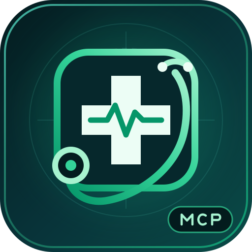

# NPPES NPI Registry Scraper — Clinic Owners ($0.50/1k)

**Category:** Healthcare & Medical Leads  
**Apify Store:** [https://apify.com/desastreger/us-healthcare-practice-owners](https://apify.com/desastreger/us-healthcare-practice-owners)  
**1-Click OAuth MCP (Zero API Key):** `https://mcp.apify.com/?tools=desastreger/us-healthcare-practice-owners`  
**Direct Standby MCP (Bearer Token):** `https://desastreger--us-healthcare-practice-owners.apify.actor/mcp`  
**Official Data Sources:** CMS NPPES NPI Registry API v2.1

> [!IMPORTANT]
> **Early-Adopter Launch Pricing:** **$0.50 / 1k records** (`$0.0005`/record) — promotional launch pricing while early adopters onboard. Scheduled to step up to our standard **$1.50 / 1k records** (`$0.0015`/record) rate after the launch window, still **75%–95% cheaper** than comparable Store scrapers.

## Overview

Query official CMS NPPES NPI Registry v2.1 organization records to extract dental, medspa, dermatology, physical therapy, optometry, and clinic Authorized Officials (owners/presidents), credentials, direct phone numbers, and corporate-chain filtering.

- **Zero External API Keys:** Runs 100% deterministically against public-domain government APIs and RFC protocols.
- **Dual Mode:** Call live over MCP (`Streamable HTTP`) from Claude, Cursor, Windsurf, VS Code, or Google Antigravity, OR run batch jobs on [Apify Store](https://apify.com/desastreger/us-healthcare-practice-owners).

---

## MCP Tool Schemas

### `search_healthcare_practice_owners`

Search US dental, medspa, dermatology, physical therapy, chiropractic, optometry, urgent care, pharmacy, and specialty healthcare practice organizations (CMS NPPES v2.1 NPI-2) to extract Authorized Official (owner/president) names, clinician credentials (DDS, DMD, MD, DO, PT), direct phone numbers, ownership classification, and 0-100 B2B lead scores.

| Parameter | Type | Description |
| :--- | :--- | :--- |
| `specialty` | `string` | Healthcare specialty preset (e.g., "dentist", "orthodontics", "dermatology", "physical_therapy", "chiropractic", "optometry", "plastic_surgery", "custom"). Default: "dentist". |
| `customTaxonomy` | `string` | Optional custom CMS NPPES taxonomy_description when specialty is "custom" (e.g., "Podiatrist", "Ophthalmology"). |
| `states` | `array` | 2-letter US state codes (e.g., ["TX", "FL"]). Default: ["TX"]. |
| `city` | `string` | Optional city filter (e.g., "Austin", "Dallas"). |
| `postalCode` | `string` | Optional 5-digit ZIP code or wildcard ZIP prefix (e.g., "752*"). |
| `requireAuthorizedOfficial` | `boolean` | Only emit practices with a named Authorized Official. Default: true. |
| `independentPracticesOnly` | `boolean` | Filter out massive corporate hospital/pharmacy/DSO chains (Walgreens, CVS, HCA, Kaiser, Aspen Dental) and multi-location corporate groups. Default: false. |
| `maxResults` | `integer` | Maximum practice owner leads to return (1-100 in MCP mode). Default: 10. |

### `lookup_practice_by_npi`

Look up a specific US healthcare practice organization by its 10-digit National Provider Identifier (NPI) from CMS NPPES v2.1 and return normalized Authorized Official, phones, taxonomy, ownership type, and lead score.

| Parameter | Type | Description |
| :--- | :--- | :--- |
| `npi` | `string` **(required)** | 10-digit US National Provider Identifier (e.g., "1043458821"). |

---

## Sample Output JSON

```json
{
  "npi": "1043458821",
  "practiceLegalName": "1-800-GO-DENTIST",
  "authorizedOfficialName": "BRADLEY K BARTELLI",
  "authorizedOfficialCredential": "D.M.D",
  "authorizedOfficialTitle": "President",
  "authorizedOfficialPhone": "(361) 851-2828",
  "city": "CORPUS CHRISTI",
  "state": "TX",
  "primaryTaxonomyCode": "1223G0001X",
  "ownershipType": "CLINICIAN_OWNED_PRIVATE_PRACTICE",
  "leadScore": 84
}
```

---

## Quickstart

### Option 1: 1-Click Browser OAuth (Zero API Key Setup)

Connect directly via Apify's managed OAuth MCP gateway — your AI client opens a browser login once and requires **no manual `APIFY_TOKEN`** in config files:

```bash
# Claude Code CLI (1-Click OAuth)
claude mcp add --transport http us-healthcare-practice-owners "https://mcp.apify.com/?tools=desastreger/us-healthcare-practice-owners"
```

**Claude Desktop / Cursor / Windsurf / Google Antigravity (`mcp_config.json`):**
```json
{
  "mcpServers": {
    "us-healthcare-practice-owners": {
      "url": "https://mcp.apify.com/?tools=desastreger/us-healthcare-practice-owners"
    }
  }
}
```

**VS Code Copilot (`.vscode/mcp.json`):**
```json
{
  "servers": {
    "us-healthcare-practice-owners": {
      "type": "http",
      "url": "https://mcp.apify.com/?tools=desastreger/us-healthcare-practice-owners"
    }
  }
}
```

### Option 2: Direct Standby Streamable HTTP (`Bearer $APIFY_TOKEN`)

For headless automation, CI/CD, or direct token-authenticated clients:

```json
{
  "mcpServers": {
    "us-healthcare-practice-owners": {
      "url": "https://desastreger--us-healthcare-practice-owners.apify.actor/mcp",
      "headers": {
        "Authorization": "Bearer <YOUR_APIFY_TOKEN>"
      }
    }
  }
}
```

### cURL (`tools/call`)

```bash
curl -sS -X POST "https://desastreger--us-healthcare-practice-owners.apify.actor/mcp" \
  -H "Authorization: Bearer <YOUR_APIFY_TOKEN>" \
  -H "Content-Type: application/json" \
  -H "Accept: application/json, text/event-stream" \
  -d '{"jsonrpc":"2.0","id":1,"method":"tools/call","params":{"name":"search_healthcare_practice_owners","arguments":{"specialty":"dentist","states":["TX"],"requireAuthorizedOfficial":true,"maxResults":5}}}'
```

### JavaScript (`apify-client`)

```js
import { ApifyClient } from 'apify-client';

const client = new ApifyClient({ token: process.env.APIFY_TOKEN });
const run = await client.actor('desastreger/us-healthcare-practice-owners').call({
  "specialty": "dentist",
  "states": [
    "TX"
  ],
  "requireAuthorizedOfficial": true,
  "maxResults": 5
});
const { items } = await client.dataset(run.defaultDatasetId).listItems();
console.log(items);
```

### Python (`apify-client`)

```python
import os
from apify_client import ApifyClient

client = ApifyClient(os.environ["APIFY_TOKEN"])
run = client.actor("desastreger/us-healthcare-practice-owners").call(run_input={"specialty":"dentist","states":["TX"],"requireAuthorizedOfficial":true,"maxResults":5})
print(client.dataset(run["defaultDatasetId"]).list_items().items)
```

---

[← Back to All 10 Open Data MCP Servers](../../README.md) · [Open on Apify Store →](https://apify.com/desastreger/us-healthcare-practice-owners)
