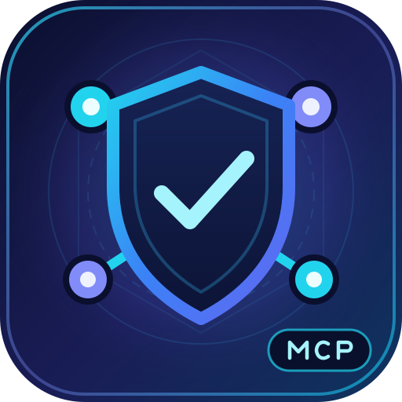

# US KYB & Compliance Scraper — SEC, LEI, FDA ($1/1k)

**Category:** KYB & Vendor Due Diligence  
**Apify Store:** [https://apify.com/desastreger/us-kyb-compliance-dossier](https://apify.com/desastreger/us-kyb-compliance-dossier)  
**1-Click OAuth MCP (Zero API Key):** `https://mcp.apify.com/?tools=desastreger/us-kyb-compliance-dossier`  
**Direct Standby MCP (Bearer Token):** `https://desastreger--us-kyb-compliance-dossier.apify.actor/mcp`  
**Official Data Sources:** GLEIF LEI, SEC EDGAR, FDA openFDA, CFPB, USASpending.gov

> [!IMPORTANT]
> **Early-Adopter Launch Pricing:** **$1.00 / 1k records** (`$0.001`/record) — promotional launch pricing while early adopters onboard. Scheduled to step up to our standard **$2.50 / 1k records** (`$0.0025`/record) rate after the launch window, still **75%–95% cheaper** than comparable Store scrapers.

## Overview

One-call US Know-Your-Business (KYB) and vendor risk due-diligence dossier aggregating GLEIF Global LEI corporate hierarchy, SEC EDGAR filings, FDA Drug & Device recalls, CFPB consumer complaints, and USASpending federal contracts.

- **Zero External API Keys:** Runs 100% deterministically against public-domain government APIs and RFC protocols.
- **Dual Mode:** Call live over MCP (`Streamable HTTP`) from Claude, Cursor, Windsurf, VS Code, or Google Antigravity, OR run batch jobs on [Apify Store](https://apify.com/desastreger/us-kyb-compliance-dossier).

---

## MCP Tool Schemas

### `screen_company_kyb`

Generate a deterministic Know-Your-Business (KYB) & vendor compliance dossier for a single company across 5 official public registries: GLEIF Global LEI, SEC EDGAR, FDA openFDA Recalls, CFPB Consumer Complaints, and USASpending Federal Contracts.

| Parameter | Type | Description |
| :--- | :--- | :--- |
| `companyName` | `string` **(required)** | Company legal or trade name to screen (e.g., "Pfizer", "Medtronic"). |
| `includeGleifLei` | `boolean` | Cross-check GLEIF Global LEI registry (ACTIVE/ISSUED status, jurisdiction, HQ address). Default: true. |
| `includeSecFilings` | `boolean` | Cross-check SEC EDGAR EFTS filings (CIK, display names, recent 10-K/10-Q/8-K/Form D filings). Default: true. |
| `includeFdaEnforcement` | `boolean` | Cross-check FDA openFDA Drug & Device recall enforcement databases. Default: true. |
| `includeCfpbComplaints` | `boolean` | Cross-check CFPB Consumer Complaint database. Default: true. |
| `includeFederalAwards` | `boolean` | Cross-check USASpending.gov prime federal contract awards (A/B/C/D). Default: true. |

### `batch_screen_companies`

Batch-screen up to 20 companies across GLEIF LEI, SEC EDGAR, FDA openFDA Recalls, CFPB Consumer Complaints, and USASpending Federal Contracts, returning deterministic 0-100 KYB verification scores, verification statuses, and risk flags.

| Parameter | Type | Description |
| :--- | :--- | :--- |
| `companies` | `array` **(required)** | Array of up to 20 company names to screen (e.g., ["Pfizer", "Medtronic"]). |
| `includeGleifLei` | `boolean` | Cross-check GLEIF Global LEI registry (ACTIVE/ISSUED status, jurisdiction, HQ address). Default: true. |
| `includeSecFilings` | `boolean` | Cross-check SEC EDGAR EFTS filings (CIK, display names, recent 10-K/10-Q/8-K/Form D filings). Default: true. |
| `includeFdaEnforcement` | `boolean` | Cross-check FDA openFDA Drug & Device recall enforcement databases. Default: true. |
| `includeCfpbComplaints` | `boolean` | Cross-check CFPB Consumer Complaint database. Default: true. |
| `includeFederalAwards` | `boolean` | Cross-check USASpending.gov prime federal contract awards (A/B/C/D). Default: true. |

---

## Sample Output JSON

```json
{
  "queriedCompany": "Pfizer",
  "resolvedLegalName": "PFIZER INC.",
  "kybVerificationScore": 100,
  "verificationStatus": "VERIFIED_ENTITY",
  "riskFlags": [
    "FDA_RECALL_HISTORY"
  ],
  "lei": "765LHXWGK1KXCLTFYQ30",
  "primaryCik": "0000078003",
  "jurisdiction": "US-DE",
  "isFederalContractor": true,
  "registriesMatchedCount": 3
}
```

---

## Quickstart

### Option 1: 1-Click Browser OAuth (Zero API Key Setup)

Connect directly via Apify's managed OAuth MCP gateway — your AI client opens a browser login once and requires **no manual `APIFY_TOKEN`** in config files:

```bash
# Claude Code CLI (1-Click OAuth)
claude mcp add --transport http us-kyb-compliance-dossier "https://mcp.apify.com/?tools=desastreger/us-kyb-compliance-dossier"
```

**Claude Desktop / Cursor / Windsurf / Google Antigravity (`mcp_config.json`):**
```json
{
  "mcpServers": {
    "us-kyb-compliance-dossier": {
      "url": "https://mcp.apify.com/?tools=desastreger/us-kyb-compliance-dossier"
    }
  }
}
```

**VS Code Copilot (`.vscode/mcp.json`):**
```json
{
  "servers": {
    "us-kyb-compliance-dossier": {
      "type": "http",
      "url": "https://mcp.apify.com/?tools=desastreger/us-kyb-compliance-dossier"
    }
  }
}
```

### Option 2: Direct Standby Streamable HTTP (`Bearer $APIFY_TOKEN`)

For headless automation, CI/CD, or direct token-authenticated clients:

```json
{
  "mcpServers": {
    "us-kyb-compliance-dossier": {
      "url": "https://desastreger--us-kyb-compliance-dossier.apify.actor/mcp",
      "headers": {
        "Authorization": "Bearer <YOUR_APIFY_TOKEN>"
      }
    }
  }
}
```

### cURL (`tools/call`)

```bash
curl -sS -X POST "https://desastreger--us-kyb-compliance-dossier.apify.actor/mcp" \
  -H "Authorization: Bearer <YOUR_APIFY_TOKEN>" \
  -H "Content-Type: application/json" \
  -H "Accept: application/json, text/event-stream" \
  -d '{"jsonrpc":"2.0","id":1,"method":"tools/call","params":{"name":"screen_company_kyb","arguments":{"companies":["Pfizer"],"includeGleifLei":true,"includeSecFilings":true,"includeFdaEnforcement":true,"includeCfpbComplaints":true,"includeFederalAwards":true}}}'
```

### JavaScript (`apify-client`)

```js
import { ApifyClient } from 'apify-client';

const client = new ApifyClient({ token: process.env.APIFY_TOKEN });
const run = await client.actor('desastreger/us-kyb-compliance-dossier').call({
  "companies": [
    "Pfizer"
  ],
  "includeGleifLei": true,
  "includeSecFilings": true,
  "includeFdaEnforcement": true,
  "includeCfpbComplaints": true,
  "includeFederalAwards": true
});
const { items } = await client.dataset(run.defaultDatasetId).listItems();
console.log(items);
```

### Python (`apify-client`)

```python
import os
from apify_client import ApifyClient

client = ApifyClient(os.environ["APIFY_TOKEN"])
run = client.actor("desastreger/us-kyb-compliance-dossier").call(run_input={"companies":["Pfizer"],"includeGleifLei":true,"includeSecFilings":true,"includeFdaEnforcement":true,"includeCfpbComplaints":true,"includeFederalAwards":true})
print(client.dataset(run["defaultDatasetId"]).list_items().items)
```

---

[← Back to All 10 Open Data MCP Servers](../../README.md) · [Open on Apify Store →](https://apify.com/desastreger/us-kyb-compliance-dossier)
