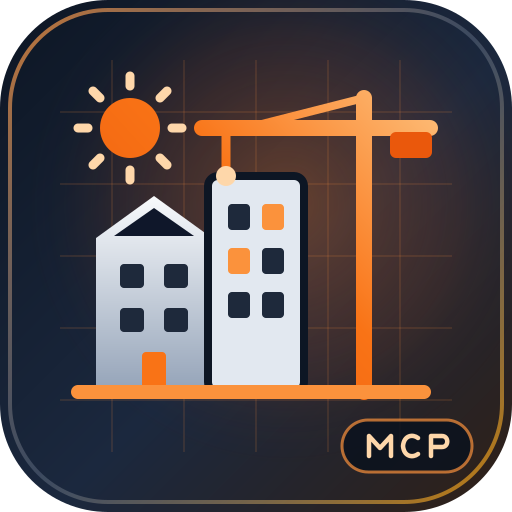

# Building Permits Scraper — Solar & Roofing ($0.50/1k)

**Category:** Construction, Solar & Trade Leads  
**Apify Store:** [https://apify.com/desastreger/us-metro-building-trade-permits](https://apify.com/desastreger/us-metro-building-trade-permits)  
**1-Click OAuth MCP (Zero API Key):** `https://mcp.apify.com/?tools=desastreger/us-metro-building-trade-permits`  
**Direct Standby MCP (Bearer Token):** `https://desastreger--us-metro-building-trade-permits.apify.actor/mcp`  
**Official Data Sources:** LA, Chicago, Austin, SF & Seattle Socrata Open Data APIs

> [!IMPORTANT]
> **Early-Adopter Launch Pricing:** **$0.50 / 1k records** (`$0.0005`/record) — promotional launch pricing while early adopters onboard. Scheduled to step up to our standard **$1.50 / 1k records** (`$0.0015`/record) rate after the launch window, still **75%–95% cheaper** than comparable Store scrapers.

## Overview

Harmonized US municipal building, solar PV, roofing, electrical, HVAC/mechanical, plumbing, and commercial remodel permits across 5 major metros (Los Angeles, Chicago, Austin, San Francisco, Seattle) with contractor names, valuations, and lead scores.

- **Zero External API Keys:** Runs 100% deterministically against public-domain government APIs and RFC protocols.
- **Dual Mode:** Call live over MCP (`Streamable HTTP`) from Claude, Cursor, Windsurf, VS Code, or Google Antigravity, OR run batch jobs on [Apify Store](https://apify.com/desastreger/us-metro-building-trade-permits).

---

## MCP Tool Schemas

### `search_metro_building_permits`

Search live municipal building, solar PV, roofing, electrical, HVAC/mechanical, plumbing, new construction, and commercial remodel permits across major US metros (Chicago, Austin, Seattle, Los Angeles, San Francisco) with contractor names, valuations, and B2B lead scores.

| Parameter | Type | Description |
| :--- | :--- | :--- |
| `metros` | `array` | US metro portals to query. Supported keys: "chicago", "austin", "seattle", "los_angeles", "san_francisco". Default: ["chicago", "austin", "seattle"]. |
| `tradeFilter` | `string` | Filter permits by specialty trade or construction category ("all", "solar", "roofing", "electrical", "hvac_mechanical", "plumbing", "new_construction", "commercial_remodel"). Default: "all". |
| `minEstimatedCostUsd` | `integer` | Minimum reported project valuation / estimated cost in USD. Default: 0. |
| `keywords` | `array` | Optional keywords matched against work description, permit type, contractor name, or address (e.g., ["EV charger", "heat pump"]). |
| `maxResults` | `integer` | Maximum permit leads to return (1-50 in MCP Standby mode). Default: 10. |

### `list_supported_permit_metros`

List all supported US municipal building permit Socrata portals (Chicago, Austin, Seattle, Los Angeles, San Francisco), their live dataset URLs, ordering fields, and supported trade filters.

_Takes no required arguments._

---

## Sample Output JSON

```json
{
  "permitId": "2026-141802 EP",
  "metro": "austin",
  "city": "Austin",
  "state": "TX",
  "tradeCategory": "SOLAR",
  "permitType": "Electrical Permit - Solar - Residential",
  "issueDate": "2026-11-09",
  "address": "4812 SHOAL CREEK BLVD",
  "estimatedCostUsd": 38500,
  "contractorName": "FREEDOM SOLAR LLC",
  "leadScore": 83,
  "priorityTier": "HOT"
}
```

---

## Quickstart

### Option 1: 1-Click Browser OAuth (Zero API Key Setup)

Connect directly via Apify's managed OAuth MCP gateway — your AI client opens a browser login once and requires **no manual `APIFY_TOKEN`** in config files:

```bash
# Claude Code CLI (1-Click OAuth)
claude mcp add --transport http us-metro-building-trade-permits "https://mcp.apify.com/?tools=desastreger/us-metro-building-trade-permits"
```

**Claude Desktop / Cursor / Windsurf / Google Antigravity (`mcp_config.json`):**
```json
{
  "mcpServers": {
    "us-metro-building-trade-permits": {
      "url": "https://mcp.apify.com/?tools=desastreger/us-metro-building-trade-permits"
    }
  }
}
```

**VS Code Copilot (`.vscode/mcp.json`):**
```json
{
  "servers": {
    "us-metro-building-trade-permits": {
      "type": "http",
      "url": "https://mcp.apify.com/?tools=desastreger/us-metro-building-trade-permits"
    }
  }
}
```

### Option 2: Direct Standby Streamable HTTP (`Bearer $APIFY_TOKEN`)

For headless automation, CI/CD, or direct token-authenticated clients:

```json
{
  "mcpServers": {
    "us-metro-building-trade-permits": {
      "url": "https://desastreger--us-metro-building-trade-permits.apify.actor/mcp",
      "headers": {
        "Authorization": "Bearer <YOUR_APIFY_TOKEN>"
      }
    }
  }
}
```

### cURL (`tools/call`)

```bash
curl -sS -X POST "https://desastreger--us-metro-building-trade-permits.apify.actor/mcp" \
  -H "Authorization: Bearer <YOUR_APIFY_TOKEN>" \
  -H "Content-Type: application/json" \
  -H "Accept: application/json, text/event-stream" \
  -d '{"jsonrpc":"2.0","id":1,"method":"tools/call","params":{"name":"search_metro_building_permits","arguments":{"metros":["chicago","austin"],"tradeFilter":"solar","minEstimatedCostUsd":15000,"maxResults":5}}}'
```

### JavaScript (`apify-client`)

```js
import { ApifyClient } from 'apify-client';

const client = new ApifyClient({ token: process.env.APIFY_TOKEN });
const run = await client.actor('desastreger/us-metro-building-trade-permits').call({
  "metros": [
    "chicago",
    "austin"
  ],
  "tradeFilter": "solar",
  "minEstimatedCostUsd": 15000,
  "maxResults": 5
});
const { items } = await client.dataset(run.defaultDatasetId).listItems();
console.log(items);
```

### Python (`apify-client`)

```python
import os
from apify_client import ApifyClient

client = ApifyClient(os.environ["APIFY_TOKEN"])
run = client.actor("desastreger/us-metro-building-trade-permits").call(run_input={"metros":["chicago","austin"],"tradeFilter":"solar","minEstimatedCostUsd":15000,"maxResults":5})
print(client.dataset(run["defaultDatasetId"]).list_items().items)
```

---

[← Back to All 10 Open Data MCP Servers](../../README.md) · [Open on Apify Store →](https://apify.com/desastreger/us-metro-building-trade-permits)
