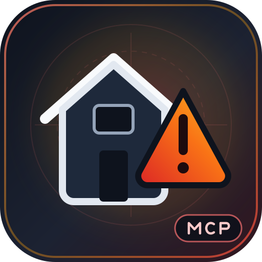

# Code Violations & Distressed Property Scraper ($0.80/1k)

**Category:** Real Estate & Distressed Property  
**Apify Store:** [https://apify.com/desastreger/us-municipal-code-violation-distressed-leads](https://apify.com/desastreger/us-municipal-code-violation-distressed-leads)  
**1-Click OAuth MCP (Zero API Key):** `https://mcp.apify.com/?tools=desastreger/us-municipal-code-violation-distressed-leads`  
**Direct Standby MCP (Bearer Token):** `https://desastreger--us-municipal-code-violation-distressed-leads.apify.actor/mcp`  
**Official Data Sources:** Austin, SF, Seattle, Buffalo, Montgomery MD & Cincinnati Socrata APIs

> [!IMPORTANT]
> **Early-Adopter Launch Pricing:** **$0.80 / 1k records** (`$0.0008`/record) — promotional launch pricing while early adopters onboard. Scheduled to step up to our standard **$2.00 / 1k records** (`$0.002`/record) rate after the launch window, still **75%–95% cheaper** than comparable Store scrapers.

## Overview

Multi-city municipal code enforcement and distressed property lead feed harmonizing 6 US Socrata open-data portals with parcel IDs, geocodes, structural/vacancy/blight classification, and investor distress scoring.

- **Zero External API Keys:** Runs 100% deterministically against public-domain government APIs and RFC protocols.
- **Dual Mode:** Call live over MCP (`Streamable HTTP`) from Claude, Cursor, Windsurf, VS Code, or Google Antigravity, OR run batch jobs on [Apify Store](https://apify.com/desastreger/us-municipal-code-violation-distressed-leads).

---

## MCP Tool Schemas

### `search_code_violation_leads`

Search active municipal code enforcement, housing habitability violations, condemned/vacant structures, blight, and distressed property leads across 6 US Socrata portals (Austin, Seattle, San Francisco, Buffalo, Montgomery County MD, Cincinnati) with parcel IDs, geocodes, distress scores, and investor priority tiers.

| Parameter | Type | Description |
| :--- | :--- | :--- |
| `metros` | `array` | US municipal portals to query. Supported keys: "austin", "seattle", "san_francisco", "buffalo", "montgomery_md", "cincinnati". Default: ["austin", "san_francisco", "buffalo"]. |
| `distressFilter` | `string` | Filter leads by property distress category ("all", "structural_hazard", "vacant_abandoned", "fire_electrical_plumbing", "housing_habitability", "unpermitted_zoning", "exterior_blight"). Default: "all". |
| `openCasesOnly` | `boolean` | When true, returns only open/active/unresolved municipal code enforcement cases. Default: false. |
| `keywords` | `array` | Optional keywords matched against violation description, violation type, status, parcel ID, or address (e.g., ["condemned", "mold", "vacant"]). |
| `maxResults` | `integer` | Maximum code violation leads to return (1-50 in MCP Standby mode). Default: 10. |

### `list_code_violation_metros`

List all 6 supported US municipal code enforcement Socrata portals (Austin, Seattle, San Francisco, Buffalo, Montgomery County MD, Cincinnati), their live dataset URLs, ordering fields, and supported distress filters.

_Takes no required arguments._

---

## Sample Output JSON

```json
{
  "caseId": "2026-148597 CC",
  "metro": "austin",
  "city": "Austin",
  "state": "TX",
  "address": "5907 EUREKA DRIVE",
  "parcelId": "0415120205",
  "distressCategory": "UNPERMITTED_ZONING",
  "status": "Pending",
  "isOpenCase": true,
  "distressScore": 69,
  "investorPriorityTier": "HIGH_MOTIVATION"
}
```

---

## Quickstart

### Option 1: 1-Click Browser OAuth (Zero API Key Setup)

Connect directly via Apify's managed OAuth MCP gateway — your AI client opens a browser login once and requires **no manual `APIFY_TOKEN`** in config files:

```bash
# Claude Code CLI (1-Click OAuth)
claude mcp add --transport http us-municipal-code-violation-distressed-leads "https://mcp.apify.com/?tools=desastreger/us-municipal-code-violation-distressed-leads"
```

**Claude Desktop / Cursor / Windsurf / Google Antigravity (`mcp_config.json`):**
```json
{
  "mcpServers": {
    "us-municipal-code-violation-distressed-leads": {
      "url": "https://mcp.apify.com/?tools=desastreger/us-municipal-code-violation-distressed-leads"
    }
  }
}
```

**VS Code Copilot (`.vscode/mcp.json`):**
```json
{
  "servers": {
    "us-municipal-code-violation-distressed-leads": {
      "type": "http",
      "url": "https://mcp.apify.com/?tools=desastreger/us-municipal-code-violation-distressed-leads"
    }
  }
}
```

### Option 2: Direct Standby Streamable HTTP (`Bearer $APIFY_TOKEN`)

For headless automation, CI/CD, or direct token-authenticated clients:

```json
{
  "mcpServers": {
    "us-municipal-code-violation-distressed-leads": {
      "url": "https://desastreger--us-municipal-code-violation-distressed-leads.apify.actor/mcp",
      "headers": {
        "Authorization": "Bearer <YOUR_APIFY_TOKEN>"
      }
    }
  }
}
```

### cURL (`tools/call`)

```bash
curl -sS -X POST "https://desastreger--us-municipal-code-violation-distressed-leads.apify.actor/mcp" \
  -H "Authorization: Bearer <YOUR_APIFY_TOKEN>" \
  -H "Content-Type: application/json" \
  -H "Accept: application/json, text/event-stream" \
  -d '{"jsonrpc":"2.0","id":1,"method":"tools/call","params":{"name":"search_code_violation_leads","arguments":{"metros":["austin","san_francisco","buffalo"],"distressFilter":"all","openCasesOnly":true,"maxResults":5}}}'
```

### JavaScript (`apify-client`)

```js
import { ApifyClient } from 'apify-client';

const client = new ApifyClient({ token: process.env.APIFY_TOKEN });
const run = await client.actor('desastreger/us-municipal-code-violation-distressed-leads').call({
  "metros": [
    "austin",
    "san_francisco",
    "buffalo"
  ],
  "distressFilter": "all",
  "openCasesOnly": true,
  "maxResults": 5
});
const { items } = await client.dataset(run.defaultDatasetId).listItems();
console.log(items);
```

### Python (`apify-client`)

```python
import os
from apify_client import ApifyClient

client = ApifyClient(os.environ["APIFY_TOKEN"])
run = client.actor("desastreger/us-municipal-code-violation-distressed-leads").call(run_input={"metros":["austin","san_francisco","buffalo"],"distressFilter":"all","openCasesOnly":true,"maxResults":5})
print(client.dataset(run["defaultDatasetId"]).list_items().items)
```

---

[← Back to All 10 Open Data MCP Servers](../../README.md) · [Open on Apify Store →](https://apify.com/desastreger/us-municipal-code-violation-distressed-leads)
